# SOA 与微服务：从服务拆分到 iceoryx 通信

## 简介

学习 SOA 和微服务时，经常会遇到一组放在一起的词：服务、接口、注册中心、消息总线、独立部署。再往实现层看，又会遇到 HTTP、RPC、DDS、共享内存和 iceoryx。这些词各自都能解释，但把它们放进同一个系统里，关系就不那么清楚了。

我们可以从一个具体的程序开始，把这些概念逐步接起来。

假设现在要开发一套测量软件。它从激光雷达采集点云，调用算法得到测量结果，最后生成报告。最初只有一个调用入口，整个流程写在一个程序里，用下面几行伪代码就可以表示：

```cpp
// 流程示意，省略错误处理与具体类型。
auto frame  = lidar.capture(region);
auto result = analyzer.measure(frame);
auto report = reporter.generate(result);
repository.save(report);
```

这个时候，程序内部已经有采集、算法、报告和存储几个模块。模块之间通过函数调用协作，数据可以通过对象或引用传递。要修改某个算法，重新构建并发布整个程序，也没有什么难以接受的地方。

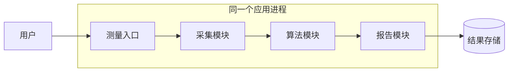

图里的箭头表示一次测量的处理顺序。用户不需要知道程序内部有哪些模块，只需要提交一次请求，然后拿到报告。这是一个完全可以工作的设计；模块划分清楚时，它也可以很好地维护。

变化通常出现在后续需求里。生产系统也想调用测量能力，运维系统想单独读取设备状态，报告生成越来越耗时，算法团队和界面团队又希望按照不同的节奏发版。此时，我们开始考虑把某些能力开放出来，或者放到独立的运行单元里。

接下来就沿着这些变化，看看 SOA 和微服务分别在处理什么问题，再用 iceoryx 解释服务拆开之后，大量数据如何在进程之间流动。文中的测量软件是贯穿全文的设计示例，代码也以说明机制为目的，不对应某个现有项目。

## 从模块到服务

### 把能力开放出来

先看生产系统想调用测量功能这件事。

一种直接的做法，是把算法库交给生产系统，让它链接进去。但这样一来，生产系统可能还要处理设备 SDK、算法依赖、配置文件，以及不同版本之间的兼容。测量软件原本负责的实现细节，就逐渐扩散到了调用方。

如果我们让测量软件继续负责这些细节，只对外提供“提交一次测量、查询测量状态、读取测量结果”几个操作，调用方需要了解的东西就会少很多。

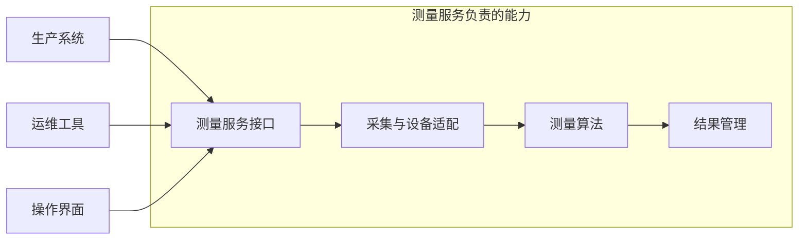

生产系统把请求交给服务接口，服务在内部完成采集和计算。运维工具或者操作界面也可以通过同一组约定使用这项能力。调用方不需要知道算法使用了哪种库，也不需要直接读取服务内部的数据表。

这里的“服务”，就是一个通过约定的交互方式对外提供的能力。我们关注的是它承担什么责任、接受什么输入，以及对结果作出什么承诺。[AWS 的 SOA 介绍](https://aws.amazon.com/cn/what-is/service-oriented-architecture/)也是从能力复用和服务组合来解释这个概念的。

需要留意，图里的一个服务内部仍然可以有很多模块。它也可能由几个协同工作的进程实现。**模块、进程和服务是在不同角度上划边界，通常不会严格一一对应。**

### 从接口继续往下看

假设测量接口接收下面这样的请求：

```json
{
  "request_id": "measure-0001",
  "region_id": "silo-a",
  "calibration_version": "calib-v3",
  "parameters_version": "surface-v2"
}
```

这些字段告诉服务：这次请求的标识是什么，要测哪个区域，使用哪个标定和参数版本。不过，仅有字段定义，还不足以让两个系统正确协作。

比如，`request_id` 相同的请求再次到达时，是重新测量，还是返回已有状态？如果服务接受了请求，却还没有开始采集，返回“成功”是否合适？测量结果里的时间是采集时间，还是报告生成时间？坐标使用哪个参考系，长度单位又是什么？

这些问题属于服务契约。接口描述怎样交互，契约进一步描述交互的含义和约束。即使消息能被正确解析，双方对时间、单位或完成条件理解不同，业务仍然会出错。

[OASIS 的 SOA 参考模型](https://docs.oasis-open.org/soa-rm/v1.0/soa-rm.pdf)把服务描述、交互和实际效果放在同一个模型中讨论。落到我们的例子里，就是不能只定义“请求长什么样”，还要定义“服务处理完以后，调用方可以相信什么”。

我们可以给刚才的接口补上一个简单约定：请求被持久化登记后，返回 `ACCEPTED`；完成采集和分析，并保存了可读取的结果后，才进入 `SUCCEEDED`。这样，调用方就能够区分“服务已经接到任务”和“测量已经完成”。后面分析超时和重试时，还会用到这个区别。

## SOA 中的服务怎样协作

### 服务提供者与消费者

把测量能力开放出来以后，测量软件成为服务提供者，生产系统成为服务消费者。同一个组件也可以同时扮演这两种角色。例如，报告服务向界面提供报告查询，同时又消费测量服务提供的结果。

SOA，即 Service-Oriented Architecture，面向服务的架构，就是通过这样的服务和契约来组织、使用与组合能力。它尤其适合讨论不同系统之间的协作：原来的实现可以保留，调用方通过明确的服务边界使用它。

因此，在已有设备系统、生产系统和报表系统的环境中，我们不必一开始就重写所有软件。可以先找到有价值的能力，为它们建立稳定的接口，再逐步组合新的业务流程。这也是 SOA 常被放在企业集成背景下讨论的原因。[IBM：SOA](https://www.ibm.com/think/topics/soa)

### 服务发现

接口确定以后，消费者还需要知道去哪里访问服务。

在规模比较小的部署中，服务位置可以写在配置里。随着实例数量增加，或者服务位置经常变化，就可以引入注册表或发现机制。提供者发布自己的信息，消费者查询这些信息，再建立实际的交互关系。

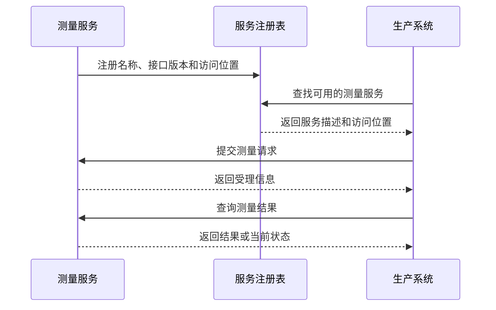

前面三次交互用于找到服务，后面的交互才是在使用测量能力。注册表保存“服务在哪里、怎样访问”的信息，并不必然负责转发测量请求。这一点很容易在架构图里被混在一起。

“提供者—注册表—消费者”是常见的解释模型，可以在 [Red Hat 的 SOA 介绍](https://www.redhat.com/zh-cn/topics/cloud-native-apps/what-is-service-oriented-architecture)中看到。具体实现不一定需要独立注册中心：固定配置和其他发现方式也可以满足实际需求。重要的是消费者能够获得足够的服务描述，并找到可以交互的提供者。

### ESB 的位置

现在再增加一点复杂度。测量系统使用自己的消息格式，生产系统使用另一套接口，老设备只能通过专有协议访问。如果每个调用方都自己完成适配，相同的转换逻辑很快就会重复出现。

这时可以把一部分集成工作交给公共组件。ESB，Enterprise Service Bus，企业服务总线，就是在这一类问题中经常出现的模式。

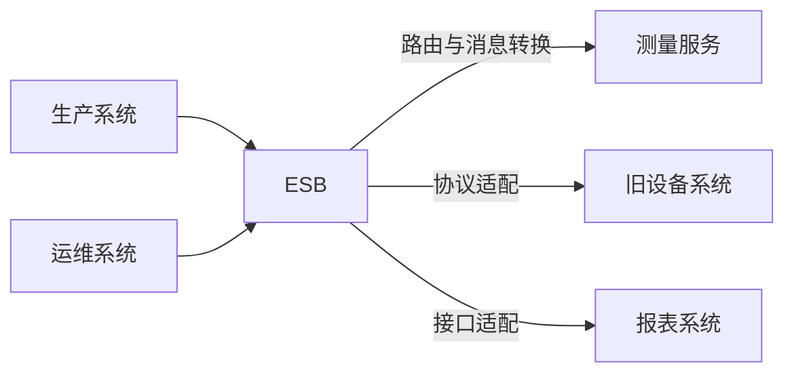

沿着生产系统到旧设备系统的路径看，请求先到 ESB，由它选择目标、完成需要的格式和协议转换，再交给后端处理。这样，调用方就不用分别理解每套系统的接入方式。

ESB 可以降低重复适配的成本，但它承担的职责也需要控制。路由和格式转换集中起来通常容易理解；如果大量业务判断也不断堆进去，修改一次流程可能就需要很多系统一起协调。总线本身的容量、故障和发布，也会影响依赖它的系统。

**ESB 是 SOA 的一种实现选择。** IBM 的介绍明确提到可以不使用 ESB 实现 SOA。因此，不能只看架构图里有没有“总线”这个方框来判断是否采用了服务化设计。[IBM：What is an ESB](https://www.ibm.com/think/topics/soa)

到这里，SOA 的主要思路已经清楚：把能力通过契约公开，解决服务之间如何理解、找到和使用彼此的问题。接下来还要处理另一个实际需求——这些能力怎样分别修改和发布。

## 微服务进一步关心什么

### 把独立发布落到实处

回到测量软件。假设算法基本稳定，报告模板却经常变化。每次修改一张报表，都需要重新发布采集和算法程序，现场还要中断正在进行的测量。把报告能力放到独立部署单元里，就有了明确的收益。

微服务架构强调围绕业务能力组织服务，并让这些服务可以独立部署、独立演进。[Lewis 和 Fowler 对微服务的介绍](https://martinfowler.com/articles/microservices.html)把独立部署作为核心特征，同时讨论了业务能力、自动化交付和去中心化治理。

这里的“独立”需要具体地看。报告服务升级到新版本时，测量服务应该能继续使用原版本运行；报告服务回滚时，也不应强迫整个系统一起回滚。它依赖的结果契约需要在约定的兼容范围内保持可用。

如果我们只是把原程序切成三个进程，却要求它们每次必须同步构建、同步升级，独立演进的收益就很有限。这种情况常被称为“分布式单体”：部署单元分开了，变更关系仍然紧紧绑在一起。

### 服务内部的数据

要实现独立发布，仅仅分开可执行文件还不够。数据往往是另一条不容易被注意到的依赖。

假设报告服务直接读取测量服务的内部结果表。现在测量团队调整表结构，报告服务就可能失效。虽然双方没有修改调用接口，数据库结构实际上已经成为它们之间的隐式接口。

一个更清楚的设计，是让测量服务负责结果的数据模型，报告服务通过公开的结果接口获取需要的信息，然后保存自己的报告数据。

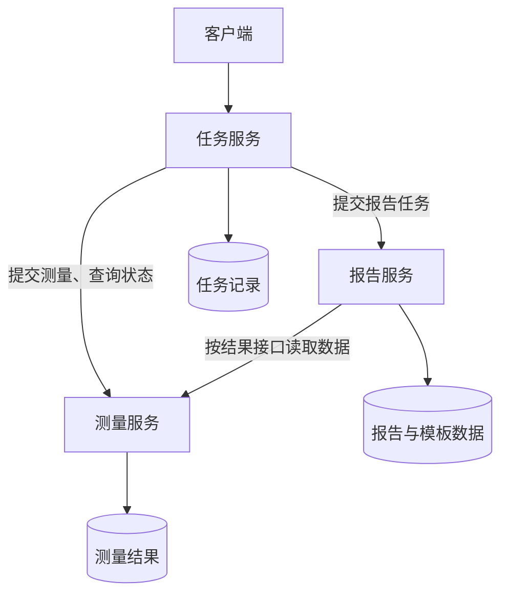

图中每个服务向下访问自己负责的数据。报告服务需要测量结果时，箭头指向测量服务的接口，避开了其内部存储结构。测量团队因此可以在维持结果契约的前提下调整内部实现。

这就是微服务中经常提到的数据所有权。它不要求每个服务都拥有一台物理数据库服务器。多个服务可以共用一台数据库服务器，同时隔离数据模型和访问权限；不过，共用服务器仍然意味着资源和故障方面存在公共依赖。[Microsoft：微服务的数据设计](https://learn.microsoft.com/en-us/azure/architecture/microservices/design/data-considerations)

服务也可以拥有持久业务状态。“无状态实例”通常是在讨论某次会话是否被绑在特定进程上，不能据此推导出服务不应该保存任务或测量结果。

### 服务应该拆多大

沿着刚才的思路继续拆，可以把采集、滤波、分割、拟合分别变成独立服务。但假如它们总是一起修改，每一步都要传递大批中间数据，而且任何一步出错都会使整条测量链失效，这样的拆分未必有价值。

相反，报告能力具有不同的发布节奏，计算资源也可以单独安排，把它独立出去通常更容易解释。

所以，粒度需要从业务能力、变更关系和运行约束推导。我们真正要观察的是：哪些东西经常一起变化，哪些状态必须一起维护，哪些部分确实需要独立扩容或隔离。

[Microsoft 的边界设计指南](https://learn.microsoft.com/en-us/azure/architecture/microservices/model/microservice-boundaries)建议检查频繁的细粒度调用、共同部署依赖和一致性成本。如果拆开以后还要不断交换内部细节，就值得重新考虑边界。

### 再看 SOA 与微服务的关系

现在可以回头理解两者的关系了。

SOA 让我们把能力公开，并考虑不同系统怎样通过契约协作。微服务则进一步把注意力放在应用内部的能力边界、数据所有权和独立交付上。这些关注点有很多交集，业界也没有一条所有人都接受的严格分界线。[Lewis 与 Fowler：Microservices and SOA](https://martinfowler.com/articles/microservices.html#MicroservicesAndSoa)

“SOA 面向企业、微服务面向应用”可以帮助理解常见背景，但不宜当作硬性定义。一个企业可以通过 SOA 整合测量、生产和报表系统，其中报表产品的内部又采用微服务。SOA 服务也可以独立部署，微服务同样会面对异构系统集成。

至于服务运行在同一台主机还是多台主机，使用进程、容器还是其他部署方式，是另外一组设计选择。容器可以帮助打包和运行，服务的边界仍然需要我们自己设计。

## 一次服务交互是怎样完成的

### 从调用函数到提交任务

在文章开头的单进程程序中，`analyzer.measure(frame)` 返回以后，后续代码就能继续使用结果。换成服务调用后，执行过程被放到了另一个运行单元里，调用方需要重新建立对执行状态的认识。

短时间查询可以采用请求响应。例如读取某个结果，提供方处理后直接返回。如果是耗时较长的建图或区域分析，保持一次调用一直等待，往往会把执行过程、连接生命周期和客户端等待混在一起。

我们可以先提交任务，再通过状态接口或消息获知进度。前面约定的 `request_id` 就用来关联这一整段过程。

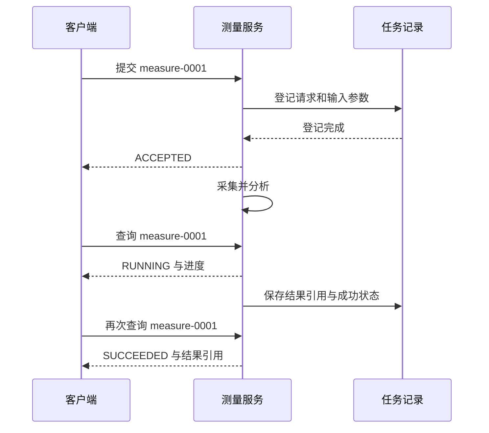

客户端第一次收到的是 `ACCEPTED`。它说明服务已经按照约定接下了任务，不能据此显示“测量完成”。后面的 `RUNNING` 描述执行过程，`SUCCEEDED` 才说明达到了成功条件。

成功条件也要具体。对于我们的例子，可以规定结果已经保存，而且能够通过返回的引用读取。这样，界面拿到的就不是一个还没写完的文件路径。

图中用查询获取状态。如果改成消息通知，执行阶段并不会消失，只是状态交付方式发生了变化。对于 ROS 2，也可以通过命令 Topic 与状态 Topic 实现这套交互，只是请求关联、去重、取消和结果留存需要由应用协议补齐。ROS 2 的 Service 是特定的请求响应抽象，与架构里的“服务”不是同一个层次的概念。[ROS 2 官方接口文档](https://raw.githubusercontent.com/ros2/ros2_documentation/jazzy/source/Concepts/Basic/About-Interfaces.rst)

### 命令与事件

再看测量完成以后生成报告这个过程。

可以由任务服务先请求测量，确认完成后，再请求生成报告。此时，下一步做什么由一个明确的协调者决定，这种方式通常称为编排，Orchestration。

也可以让测量服务发布“测量已经完成”的事件，报告服务订阅这个事件，自行开始生成报告。这种方式把协作分散到各个参与者，通常称为事件协作，Choreography。

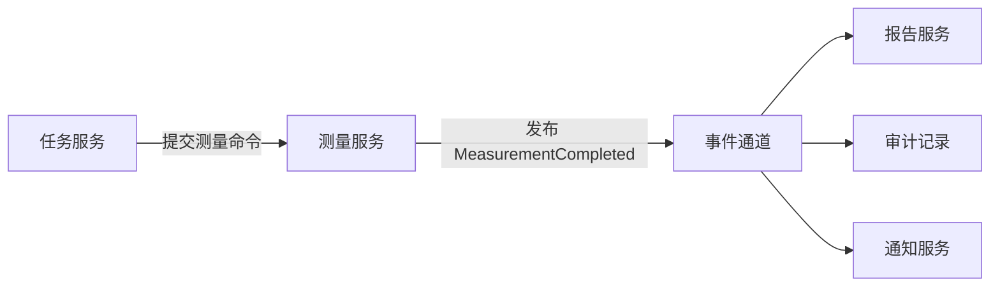

沿着图看，测量服务只负责声明自己的结果已经产生，报告、审计和通知根据各自的需要处理事件。增加一个新的消费者时，测量逻辑未必需要改动；但如果业务要求所有后续处理都完成后，整个任务才算成功，还需要明确谁来汇总这些结果。

这里，“提交测量”表达的是执行意图，“测量完成”表达的是已经发生的事实。假如把刚收到请求就发出的消息命名为 `MeasurementCompleted`，后续服务就会在错误的时刻开始工作。

微服务可以使用编排和消息路由，也可以同时使用请求响应和事件。具体怎么组合，取决于流程复杂度和故障处理方式，不能用“有消息总线”或“有协调者”来否定它的微服务性质。[Microsoft：微服务架构中的组件](https://learn.microsoft.com/en-us/azure/architecture/guide/architecture-styles/microservices)

### 消息格式与通信机制

上面的请求可以用 JSON 表示，通过 HTTP 发送；也可以使用 RPC 框架，或者放进消息中间件。替换这些技术，并不会自动改变“提交任务、观察状态、读取结果”的业务关系。

因此，阅读资料时要留意名词所在的层次。JSON 是数据格式，HTTP 是协议，REST 是架构风格，gRPC 和 Thrift 是 RPC 框架，ActiveMQ 是消息中间件产品。它们经常一起出现，但承担的角色不同。[RFC 8259](https://www.rfc-editor.org/rfc/rfc8259)、[gRPC 官方介绍](https://grpc.io/docs/what-is-grpc/introduction/)

对于连续点云，发布订阅会比较自然；对于一个短查询，请求响应容易理解；对于持续几十秒甚至更久的工作，则需要完整的任务生命周期。先把交互的含义想清楚，再选择承载它的技术，接口设计会更稳定。

## 异常发生以后

### 超时发生在哪一段

现在考虑一个容易出问题的情况：报告已经生成，返回客户端的响应却丢了。

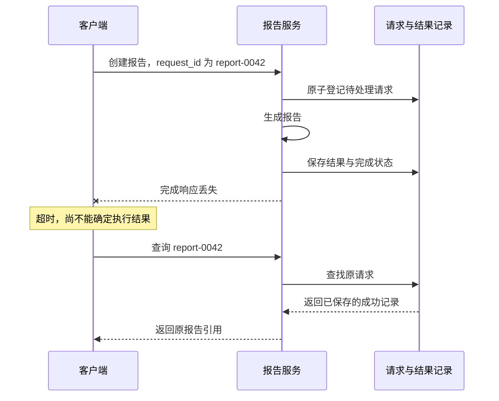

图中真正失败的是响应交付，报告生成本身已经完成。如果客户端把超时直接当作“没有执行”，然后用新的请求标识再创建一次报告，就可能产生重复操作。

所以，超时首先改变的是调用方对结果的认知。服务端可能还没开始，也可能执行中，甚至已经成功。重试是否合适，需要结合操作语义、错误类型和时间预算判断。[Microsoft：Retry 模式](https://learn.microsoft.com/en-us/azure/architecture/patterns/retry)

这种不确定性也会出现在同机进程间通信里。对方进程崩溃、响应处理被阻塞，都可能使调用方拿不到结果；跨主机以后，还会增加网络分区等情况。

### request_id 为什么需要保存

为了处理重复请求，我们可以围绕请求标识保存一份执行记录。下面用伪代码表示接收阶段的逻辑：

```text
accept(request):
    在本地事务中：
        existing = 按 request_id 查找记录

        如果记录已经存在：
            如果参数摘要不同：拒绝这次请求
            否则：返回已有状态和结果引用

        否则：
            以 request_id 为唯一键插入 ACCEPTED 记录
            如果发生唯一键冲突：
                回滚本次事务
                重新读取已提交记录，进入已有请求处理分支
            插入持久化待执行任务

    提交事务
    返回 ACCEPTED
```

这段逻辑的关键，是请求判重与登记需要原子化。本例需要对 `request_id` 建立唯一约束，并把请求记录与待执行任务放在同一个本地事务中。两个并发请求即使都查到“记录不存在”，也只能有一个成功插入；另一个遇到冲突后，回滚并重新读取已有记录，再校验参数。普通的“先查询、再插入”事务本身并不能保证这一点，也可以选择可串行化事务等能够提供等价保证的机制。执行器随后从持久化任务中取出工作，并按照允许的并发规则推进状态。

同一个请求标识也不能被随意复用。如果 `report-0042` 第一次要求生成区域 A 的报告，第二次却要求生成区域 B 的报告，服务应该明确拒绝冲突，而不是默默返回第一次的结果。

重复执行同一逻辑请求后，预期业务效果与执行一次相同，这就是这里需要的幂等语义。但接收阶段的判重还不能覆盖整个执行过程。程序可能在外部动作已经完成、成功记录尚未保存时崩溃。重启后如何确认外部结果，仍需要单独设计。

例如，创建报告可以使用稳定的结果标识和受控的文件提交过程；设备动作则可能需要查询设备实际状态。不能因为协议里加了一个 `request_id`，就直接宣称所有业务操作都实现了“恰好一次”。

### 拆开以后的一致性

服务各自管理数据以后，还会遇到另一种中间状态：测量结果已经保存，但“测量完成”事件还没有成功送到报告服务。

一种常见设计，是在本地事务里同时保存结果状态与待发送事件，再由发送器逐步投递。发送器可能重复发送，因此消费者还需要去重。这样就把“业务状态已提交，但事件暂时没送出”变成一个能够继续推进和检查的状态。它并不意味着几个服务的数据在任何时刻都完全一致。

如果流程中已经完成的步骤需要撤销，还可以设计业务补偿。例如，报告任务创建失败后，释放之前预留的计算资源。Saga 一类模式就是把长流程拆成本地事务，再安排失败后的后续动作或补偿。补偿本身也会失败，而且不一定能够恢复原来的每个细节。[Microsoft：补偿事务模式](https://learn.microsoft.com/en-us/azure/architecture/patterns/compensating-transaction)

这些复杂度解释了为什么服务不宜无限细分。两个操作如果始终需要一起完成、一起失败，把它们保留在同一个能力边界内，有时会让实现清楚得多。

### 让执行过程能够被观察

真正上线以后，我们还需要把同一次请求在各个服务里的记录连起来。请求标识可以出现在日志和状态中，跨服务调用也可以记录追踪信息。排障时才能知道，时间消耗在采集、算法、排队，还是结果交付上。

队列也需要有容量边界。生产速度持续超过消费速度时，无限排队只会让延迟和内存占用继续增长。可以拒绝新任务、限制并发，或者按照业务允许的策略丢弃旧数据。对于持续失败的依赖，还可以暂时停止继续调用，也就是常说的熔断。

这些机制都要和业务含义连起来：实时显示可能接受跳帧，原始记录若要求完整保存，就必须检测和报告数据缺失。一次发送成功，只能说明发送路径达到了某个约定阶段，不能替代整条业务链的完成证据。

## 从消息传递到共享内存

### 大数据带来的问题

前面讨论的请求和状态通常很小。点云却可能每帧就有几 MiB，而且算法、可视化和记录器都想消费同一帧。

如果每个消费者都得到一份独立复制，数据量和订阅者增加以后，内存带宽、缓存和分配开销都可能成为问题。此时，“如何拆分服务”和“如何高效传数据”就开始发生联系。

假设采集、算法和记录都在同一台工业 PC 上，我们可以让它们访问同一片共享内存。采集进程在共享数据块里准备一帧点云，其他进程获取该数据块的引用，在有效期内读取。这样，进程之间传递这帧数据时，就不必为每个消费者复制整份 payload。

iceoryx 正是在这个层面提供能力的通信中间件。它可以成为服务化系统的数据传输基础，但服务边界、业务契约和独立发布策略仍然需要由应用设计。[Eclipse iceoryx 官方仓库](https://github.com/eclipse-iceoryx/iceoryx)

### iceoryx 的进程模型

下面沿着所给参考文章讨论的经典 iceoryx 模型继续展开。这个模型包含应用内的 Runtime、独立的 RouDi，以及由参与进程映射使用的共享内存。

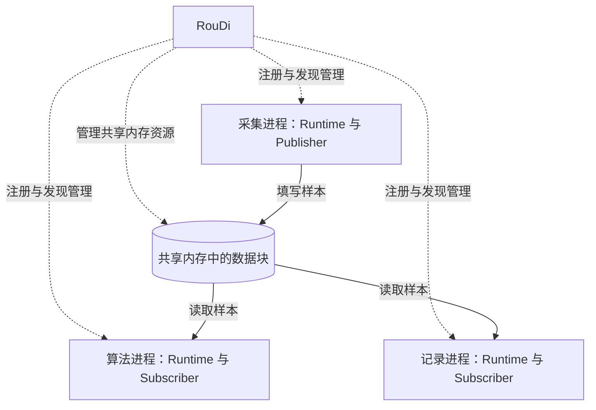

先看虚线。应用通过 Runtime 与 RouDi 建立联系，RouDi 负责通信建立、发现和相关资源管理。再看实线，业务 payload 由发布者写入共享内存，订阅者直接访问相应样本；图中的实线表示数据访问关系，不表示复制。

这两类关系可以分别理解为管理路径和数据路径。RouDi 参与建立和管理通信，但不会像逐消息转发的代理一样，把每一帧点云接过来再发给订阅者。[iceoryx 官方 Overview](https://github.com/eclipse-iceoryx/iceoryx/blob/main/doc/website/getting-started/overview.md#roudi)

这里需要区分版本。经典 iceoryx 的 RouDi 模型与 iceoryx2 的实现不同，后者不再需要中央 RouDi。按 2026-10-21 核验到的 classic README，经典项目已进入维护模式，维护者建议新项目关注 iceoryx2。本文继续讲经典模型，是为了把参考文章中的机制解释清楚。[classic 状态说明](https://github.com/eclipse-iceoryx/iceoryx)、[官方开发者会议记录](https://github.com/eclipse-iceoryx/iceoryx/wiki/2024-11-05-Eclipse-iceoryx-developer-meetup)

### 通信对象的描述

发布者和订阅者要建立关系，首先得说明自己发布或需要的是哪路数据。经典 iceoryx 使用 `Service / Instance / Event` 三元组描述通信对象。例如，可以把一组描述理解为：

```text
Service  = Lidar
Instance = Front
Event    = PointCloud
```

这里是为本文点云例子选择的名称。官方 icedelivery 示例使用的是 `Radar / FrontLeft / Object`。发布端与订阅端使用相匹配的描述，框架据此处理发现和连接关系。[官方 icedelivery 示例](https://github.com/eclipse-iceoryx/iceoryx/blob/main/iceoryx_examples/icedelivery/README.md)

三元组能够帮助识别通信对象，却不包含完整的业务语义。`PointCloud` 使用什么坐标系，时间戳来自哪里，字段布局是什么，仍要由应用的数据契约说明。这和前面讨论的服务契约是连在一起的：中间件把数据送到正确的位置，应用双方还必须以同一种含义解释它。

### 一块共享内存的生命周期

建立了发布订阅关系以后，就可以看一帧数据是怎样流动的。为了避免业务 payload 的额外复制，发布者先从共享内存池借出一个块，再直接往里面构造或填写数据。

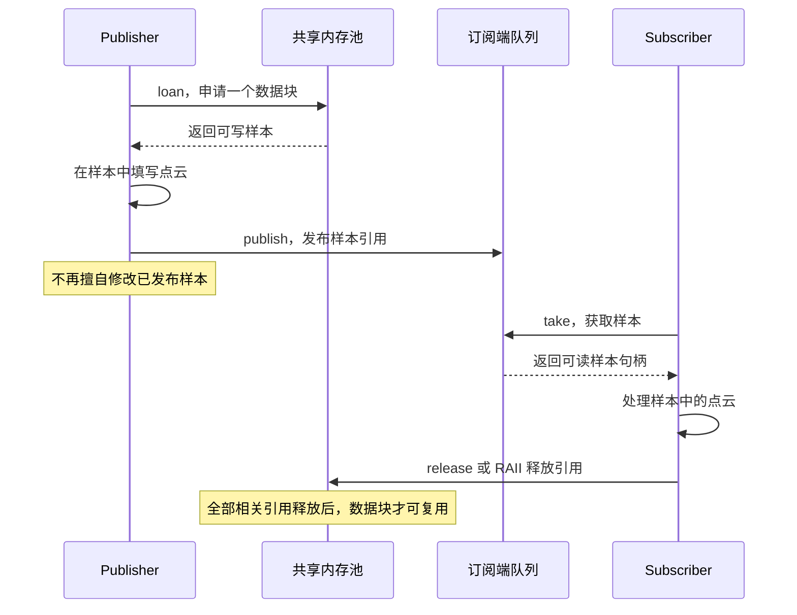

图中最容易忽略的是 `loan`。它把分配过程放在数据填写之前，使应用有机会直接在可以共享的位置生成数据。如果先在私有内存中构造整帧，再复制进共享块，那么后面的进程间传输可以避免复制，前面这一次搬运仍然存在。

`publish` 之后，发布者就要遵守样本的所有权约定。它不能继续通过保存下来的指针随意修改数据，否则消费者正在读取的内容就可能改变。

订阅者通过 `take` 获取样本，处理结束后释放引用。类型化 C++ 接口可以借助 RAII 管理样本的生命周期，未类型化接口则需要按 API 显式释放。下面的伪代码只表示这个生命周期，不是可直接编译的 iceoryx API 用法：

```text
发布端：
    sample = loan()
    如果借用失败：执行约定的容量处理策略
    否则：
        在 sample 中填写数据
        publish(sample)
        不再通过旧句柄修改样本

订阅端：
    sample = take()
    如果有可用样本：
        在有效期内读取数据
        release(sample)
        不再保存并访问样本中的指针
```

一个数据块可能同时被多个订阅者持有，发布者的历史缓存也可能保留引用。因此，一个消费者释放以后，块不一定立即回到内存池；只有相关引用全部释放，才具备复用条件。[官方 icedelivery 示例](https://github.com/eclipse-iceoryx/iceoryx/blob/main/iceoryx_examples/icedelivery/README.md)、[共享内存通信说明](https://github.com/eclipse-iceoryx/iceoryx/blob/main/doc/shared-memory-communication.md)

### 为什么普通指针会成为问题

现在设想，点云消息里放了一个普通 `std::vector<Point>`。对象本身通常只保存管理信息，真正的点数组位于当前进程的堆中。把这个对象放进共享内存，并不会把它所指向的私有堆自动变成其他进程可访问的数据。

这就是共享内存传输对类型提出限制的原因。payload 本身及其引用到的内容都必须适合共享访问；普通堆指针、依赖进程私有动态分配的容器，不能未经处理就作为跨进程对象使用。双方还必须约定大小、对齐和字段布局。[iceoryx 的类型限制](https://github.com/eclipse-iceoryx/iceoryx/blob/main/doc/website/getting-started/overview.md#restrictions)

即使映射的是同一片共享内存，不同进程中的虚拟地址也可能不同，所以定位共享对象时不能盲目交换本进程中的绝对地址。iceoryx 的相关内部结构使用相对定位机制处理这一问题。[共享内存通信说明](https://github.com/eclipse-iceoryx/iceoryx/blob/main/doc/shared-memory-communication.md)

到这里也能看出，共享内存只是减少了特定数据路径上的复制，并没有消除兼容性问题。消息结构修改以后，收发双方仍然要正确解释数据。一个紧密依赖二进制布局的接口，在独立升级时尤其需要明确版本配合方式。

### 慢消费者会留下什么

共享内存的数据块数量是有限的。假如记录器因为磁盘变慢，一直持有较早的样本，这些块就不能及时回收。采集进程继续申请新块，最终可能遇到容量不足。

队列策略会决定后续表现：可以丢弃旧数据、阻塞某条路径，或者返回申请失败。具体行为取决于使用的接口与配置，不能仅凭“零拷贝”就推断系统不会积压。[iceoryx 官方 FAQ](https://github.com/eclipse-iceoryx/iceoryx/blob/main/doc/website/FAQ.md)

用一个简单数值看容量关系。假设每帧占用一个 4 MiB 的数据块，每秒产生 20 帧，并且需要完整保留最近 0.5 秒的不同帧，那么这部分 payload 就约占：

```text
4 MiB × 20 帧/秒 × 0.5 秒 = 40 MiB
```

这只是示例中的 payload 规模，还没有加上正在填写的块、突发、历史缓存、元数据、对齐和容量余量。多个订阅者读取同一帧时，不应直接把整帧容量乘以订阅者数量；但如果各自持有不同时间段的帧，实际不能回收的块集合仍然会变大。

所以，实时显示、算法和记录器可以有不同策略。显示旧帧没有意义时，可以选择丢旧保新；算法是否允许跳帧，要看计算约束；记录器若要求完整保存，就需要吞吐保障和数据缺失检测。这些最终仍是业务决策。

## 把架构与通信放在一起

经过前面的拆解，我们可以为这个测量系统画出一张更完整的关系图。

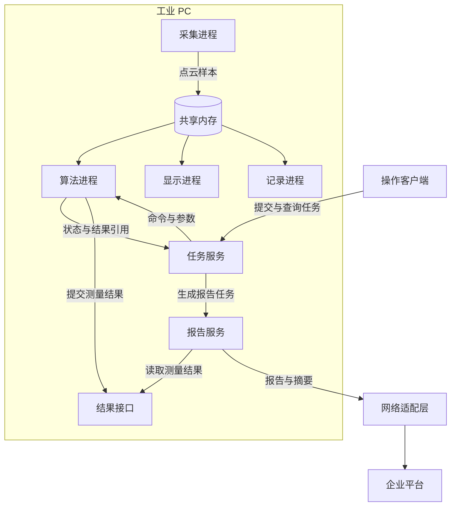

先看中间的数据路径。采集进程产生大块点云，算法、显示和记录进程读取这些数据，同机共享内存可以用于减少这里的传输开销。

再看任务路径。任务服务下发命令和参数，算法返回执行状态与结果引用，报告服务根据结果生成报告。任务消息和结果契约，把不同能力的责任连接起来。

最后看企业平台。远端通常不需要跟本地进程共享同一个内存块，而是通过网络接口接收报告、摘要或者需要传输的数据。经典 iceoryx 的核心共享内存路径服务于同机通信，跨主机可以结合网络协议或网关，例如官方的 DDS Gateway。网络段仍需要分别评估序列化、复制和延迟。[官方 DDS Gateway](https://github.com/eclipse-iceoryx/iceoryx-gateway-dds)

这三类关系可以存在于同一个系统里。SOA 帮助我们理解能力如何公开与组合，微服务帮助我们检查能力是否能够独立交付，iceoryx 则处理其中一段具体的数据传输问题。

如果实际需求只是一台设备、一个小团队维护，前面这些能力也可以先作为模块存在，必要时才拆进程。报告有独立发版需求，就先拆报告；算法需要隔离资源，就研究算法进程的边界；只有确认大数据复制是瓶颈，才进一步评估共享内存路径。

判断设计是否合适，可以拿一次真实变更来推演：替换报告实现需要改哪些服务，升级算法是否要求调整消息布局，一个消费者变慢会拖住哪些路径。能够把这些影响解释清楚，架构图上的边界才有实际意义。

## 参考资料

本文的展开方式参考了[《SOA 框架 iceoryx 原理解析》](https://yizhi.ren/2024/06/22/iceoryx/)。SOA、微服务和通信实现的论点，在正文中分别链接到对应资料。

继续阅读时，可以先看 [AWS 的 SOA 介绍](https://aws.amazon.com/cn/what-is/service-oriented-architecture/)与 [Red Hat 的 SOA 介绍](https://www.redhat.com/zh-cn/topics/cloud-native-apps/what-is-service-oriented-architecture)，再结合 [Lewis 与 Fowler 的 Microservices](https://martinfowler.com/articles/microservices.html)理解独立部署的含义。需要从具体产品中抽离概念时，可以查阅 [OASIS SOA 参考模型](https://docs.oasis-open.org/soa-rm/v1.0/soa-rm.pdf)。

iceoryx 部分可以配合 [Overview](https://github.com/eclipse-iceoryx/iceoryx/blob/main/doc/website/getting-started/overview.md) 和 [icedelivery 示例](https://github.com/eclipse-iceoryx/iceoryx/blob/main/iceoryx_examples/icedelivery/README.md)继续阅读。实际选型时，还应单独核对 [iceoryx2](https://github.com/eclipse-iceoryx/iceoryx2) 的目标版本，避免把经典实现中的 RouDi、接口和生命周期细节直接套过去。
