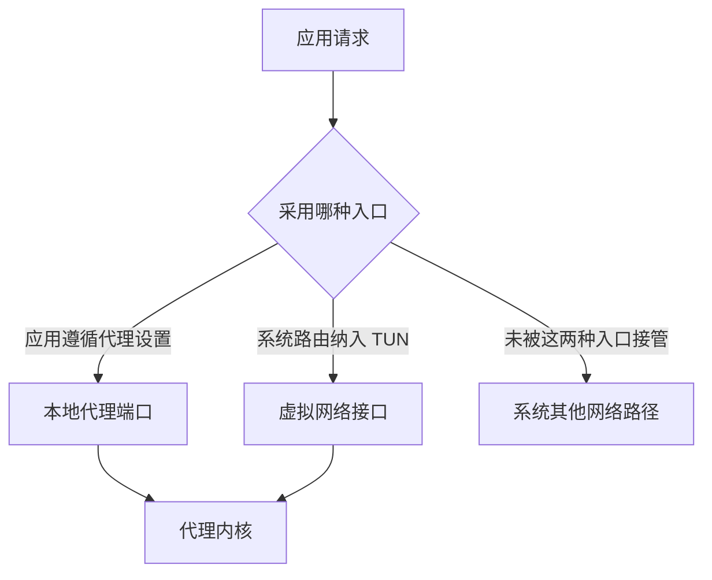
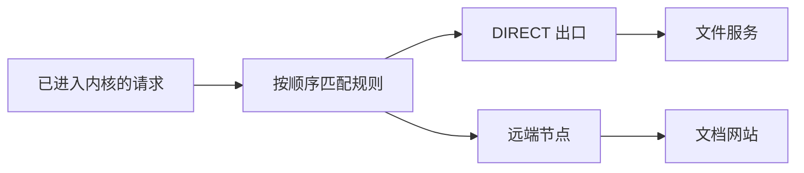

## 简介

使用代理客户端时，常见的几个开关是“系统代理”“TUN”和“规则模式”。它们经常出现在同一个窗口里，很容易被理解成几种效果相近的上网方式。

但实际使用时，又会遇到一些不太符合直觉的现象：浏览器已经走代理，终端里的程序却没有；关闭系统代理后，连接仍然出现在客户端里；明明开启了 TUN，有些请求却显示 `DIRECT`。

我们可以从一个简单的需求开始。假设一台电脑需要访问文档网站，同时还要访问本地网络里的文件服务。我们希望前者经过远端节点，后者沿本地网络访问。下面用这个示例，把请求经过的几层逐步接起来。域名与配置片段均为示意。

## 请求怎样进入代理

先看浏览器访问文档网站。

开启系统代理后，客户端通常会把本地监听地址写入操作系统的代理设置。遵循这些设置的应用，会把相应请求交给这个地址，再由代理程序处理。macOS 的设置中就分别提供 HTTP、HTTPS、SOCKS 和 PAC 等选项。[Apple：代理设置](https://support.apple.com/en-euro/guide/mac-help/-mchlp2591/mac)

这里需要应用参与：有的程序读取系统设置，有的使用自己的配置，也有的只读取环境变量。浏览器能够访问，只能说明浏览器这条路径可用，不能据此判断另一个程序也采用了相同入口。

TUN 则把入口放在另一层。它通过虚拟网络接口，配合操作系统的路由，把纳入接管范围的数据包送入代理内核。应用通常不需要知道本地 HTTP 代理的地址。实际接管范围仍取决于路由、排除项、权限以及平台实现。[Mihomo：TUN](https://wiki.metacubex.one/en/config/inbound/tun/)



图里两条进入内核的箭头，表示不同的接管方式。它们可以同时存在，也各有作用范围。因此，关掉系统代理，并不等于停掉 TUN 路由；程序声明“不使用 HTTP 代理”，也不能单凭这一点证明数据包没有经过虚拟网络接口。

例如，`curl --noproxy '*'` 可以让 curl 对所有目标跳过它的代理配置。这个参数改变的是 curl 的行为，不会替操作系统撤销 TUN 路由。[curl：--noproxy](https://curl.se/docs/manpage.html#--noproxy)

## 进入内核之后，才开始选择出口

接下来考虑文档网站和文件服务怎样分开走。

请求进入代理内核后，内核需要决定采用哪个出口。在规则模式下，可以根据域名、地址等信息匹配规则，再选择直接连接或者交给远端节点。TUN 负责把请求带进来，规则负责决定带进来之后如何处理。

下面是一个简化的 Mihomo 规则片段。`Remote` 代表另外定义的代理或策略组，这几行不能单独作为完整配置导入：

```yaml
mode: rule
rules:
  - DOMAIN,files.example.com,DIRECT
  - DOMAIN,docs.example.com,Remote
  - MATCH,DIRECT
```

访问文件服务时，第一条规则指定直接连接；访问文档网站时，第二条选择 `Remote`；其余请求采用末尾的兜底策略。这里选择兜底直连，只是为了说明规则含义。实际使用中，应明确未识别流量该走哪里，而不是无意间继承某份模板的选择。

Mihomo 的规则按从上到下的顺序匹配，前面的规则具有更高优先级。特定例外应放在能覆盖它的宽泛规则之前，兜底规则通常放在最后。[Mihomo：路由规则](https://wiki.metacubex.one/en/config/rules/)



这也解释了为什么开启 TUN 后仍然可以看到 `DIRECT`。请求先被接管，再由内核直接建立连接，是正常的一条处理路径。`DIRECT` 描述的是这个内核选择的出口；系统里若还存在其他 VPN 或网络设备，后续路径仍可能受它们影响，不能把这几个字当作整条网络路径的证明。[Mihomo：DIRECT](https://wiki.metacubex.one/en/config/proxies/direct/)

## DNS 为什么返回一个陌生地址

沿着请求再往前看一步，应用通常还要先查询域名。在 fake-IP 模式下，客户端可以给域名分配一个合成地址，并维护两者之间的映射。应用随后连接这个地址，代理内核再利用映射恢复目标域名，继续处理连接。

所以，这个地址不一定是目标网站的真实服务器地址，更不是远端节点的公网出口。它在这里承担的是本地映射标识的作用。Mihomo 的 DNS 配置把 fake-IP 地址范围和例外域名单独列出，正是因为有些域名或应用需要采用不同处理方式。[Mihomo：DNS 配置](https://wiki.metacubex.one/en/config/dns/)

DNS 查询与业务连接也需要分开理解：前者解决名称如何解析，后者决定数据如何传输。看到一个合成地址，能够帮助识别当前 DNS 处理方式，却不足以判断请求最终选择了哪个出口。

## 配置文件和当前状态之间，还隔着什么

理解了这条路径以后，“规则写好了却没生效”也就有了更具体的含义。

磁盘上保存的文件是输入，内核当前运行的配置才决定行为。图形客户端可能管理多份配置，也可能合并附加规则；即使文件里写着 `mode: rule`，界面中的运行模式仍需要核对。Mihomo 本身区分 `rule`、`global` 和 `direct` 三种模式。[Mihomo：运行模式](https://wiki.metacubex.one/en/config/general/#operation-mode)

因此，查看当前启用项、实际运行模式，以及一条新连接命中的规则，比只打开文件搜索某个域名更有说明力。这里验证的是这条连接的处理路径；应用完整功能是否正常，还需要回到实际操作中确认。

换设备时，也要沿着同样的层次看。界面名称相似，不代表内置的代理内核相同；文件能够解析，不代表协议和字段都受到支持。桌面网卡名、进程匹配和手机应用选择，都依赖所在平台。Mihomo 的 TUN 文档也对平台专属选项作了区分，配置不能只靠复制文件来完成迁移。

对于开头那台需要同时访问文档网站和文件服务的电脑，我们最终需要确认的关系就很清楚了：应用的请求从哪里进入，内核现在采用什么规则，规则又把连接交给哪个出口。把这条路径画明白以后，每个开关的职责也就有了落点。
