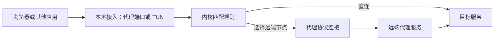
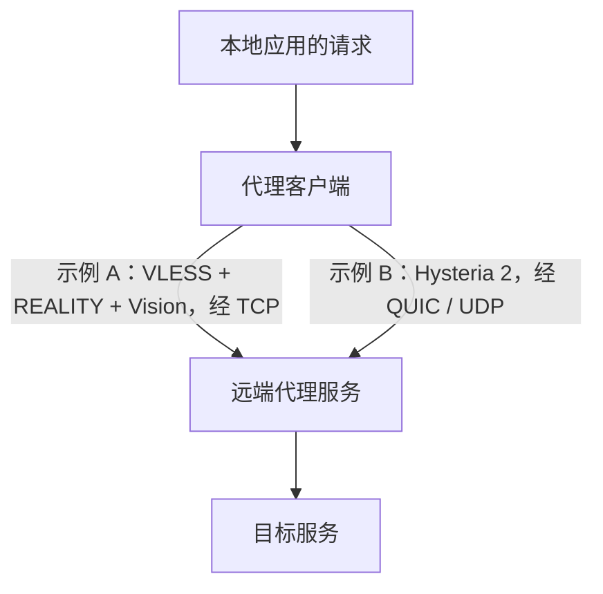

## 简介

别人问“你用的是什么协议”，回答时很容易把软件名、协议名和端口一起报出来：Clash Verge、VLESS、REALITY、Vision、TCP 443，好像这些词都在描述同一件事。

它们其实分别回答了不同的问题：谁提供操作界面，谁处理连接，请求怎样送到远端，以及数据通过什么方式传输。

我们可以从一个具体场景开始。假设浏览器需要通过一台远端服务器访问文档网站，电脑上装了一个代理客户端。先沿着这次请求走一遍，再把协议名称放回各自的位置。下文采用通用示例，不对应某台实际服务器。

## 请求先进入谁

打开客户端时，我们看到的是节点列表、开关和规则编辑器。以 Clash Verge Rev 为例，它提供图形界面，实际处理代理连接的是配套的 Mihomo 内核。这两者是软件之间的分工。[Clash Verge Rev 项目说明](https://github.com/clash-verge-rev/clash-verge-rev#features)

浏览器还要有办法把请求交给内核。它可以遵循系统代理设置，连接本机的代理端口；也可以在相应的系统路由配置下，通过 TUN 虚拟网络接口进入客户端。TUN 解决流量如何接入的问题，启用后的范围仍受路由和排除项影响。[Mihomo TUN 配置](https://wiki.metacubex.one/config/inbound/tun/)

进入内核之后，规则决定这次连接走哪个出口：直接连接目标，还是交给某个远端节点。规则可以按域名、地址、进程等条件匹配；代理协议则负责已经选定的那条远端连接。[Mihomo 路由规则](https://wiki.metacubex.one/config/rules/)

所以，打开 TUN、选中一个节点、开启规则模式，是三个不同的动作。排查问题时，也要分别确认流量有没有进入客户端、命中了哪条规则、实际使用了哪个出口。

## 拆开 VLESS + REALITY + Vision + TCP

现在假设规则选择了一个使用这套组合的节点。

VLESS 描述客户端与服务端之间的代理交互，包括身份信息和转发请求。REALITY 是这套组合采用的传输安全机制。Vision 对应 XTLS 的处理方式，在配置中常见为 `flow: xtls-rprx-vision`；它不是另一台需要经过的服务器。TCP 则承担这段连接底层的可靠字节传输。[Project X 的 VLESS 说明](https://xtls.github.io/en/config/inbounds/vless.html)、[REALITY 官方示例](https://github.com/XTLS/REALITY/blob/main/README.en.md)

把这些名称摆到一张表里，会更容易读配置：

| 名称 | 在这个示例中负责什么 |
| --- | --- |
| VLESS | 表达代理请求，按协议完成客户端身份校验 |
| REALITY | 为客户端到代理服务端的连接提供传输安全机制 |
| XTLS Vision | 选择特定的数据处理方式，配合支持的传输组合工作 |
| TCP | 承载客户端与代理服务端之间的字节流 |
| 443 | 服务监听的端口号 |

这里描述的是一组搭配，不能据此推断所有 VLESS 配置都使用 REALITY，也不能看到 VLESS 就认为加密方式已经确定。阅读时要把协议、传输方式和安全设置一起看。

还有一个容易混淆的边界：**客户端到代理服务器，以及代理服务器到目标网站，是两段连接。** 网站自己的 HTTPS 通常仍由浏览器与网站完成端到端的 TLS 交互，代理负责转发；这与前一段代理连接使用什么传输组合是不同的问题。

因此，“服务开在 443”提供的信息很有限。TCP 443 和 UDP 443 是不同的传输端点；端口可连接，也不能单独证明协议握手、身份验证或实际请求已经成功。

## 换成 Hysteria 2，改变了哪里

如果把选中的节点换成 Hysteria 2，变化主要发生在客户端与远端代理之间。Hysteria 2 基于 QUIC，能转发 TCP 和 UDP 流量；标准 QUIC 运行在 UDP 之上，并提供流、加密握手和丢包恢复等机制。[Hysteria 2 协议说明](https://v2.hysteria.network/docs/developers/Protocol/)、[RFC 9000](https://www.rfc-editor.org/rfc/rfc9000.html)

这也解释了一个看似矛盾的现象：浏览器发起的 TCP 连接，可以通过基于 UDP 的代理链路传输。应用请求使用什么协议，与中间代理链路采用什么协议，需要分开看。

图中的两条线表示两种可选方案。它们没有改变目标网站本身，也不会自动修正一条错误的分流规则。

实际表现还取决于设备到服务器的链路、服务器资源和客户端实现。QUIC 的用户态处理也会消耗 CPU；因此，仅凭协议名称不能判断哪套方案一定更快。[Hysteria 性能说明](https://v2.hysteria.network/docs/advanced/Performance/)

如果要比较，可以固定设备、目标服务和测试内容，只切换代理连接方案，分别观察连接成功率、上传与下载完成时间，以及空闲后重新请求的表现。一次短下载只能反映当时的一小段情况，不能代替持续使用的稳定性。测试时也要记录最终选中的节点，避免自动切换把两条线路的结果混在一起。

## BBR 应该放在哪一层理解

配置服务器时，还经常看到“开启 BBR”。BBR 是拥塞控制算法，用于决定发送速度如何随网络状态调整。

Linux 的 `net.ipv4.tcp_congestion_control` 设置针对内核 TCP。Hysteria 的 QUIC 实现有自己的拥塞控制选择；即使其中也采用 BBR，它也不是通过这个 TCP 开关自动启用的。[Linux TCP 参数说明](https://docs.kernel.org/networking/ip-sysctl.html#tcp-variables)、[Hysteria 拥塞控制配置](https://v2.hysteria.network/docs/advanced/Full-Server-Config/#congestion)

由这个分工可以进一步看出：内核 TCP 设置可能影响代理服务器连接目标网站的 TCP 段，但不能据此声称客户端到服务器的 QUIC 段已经得到相同优化。调优前，先确认瓶颈在哪一段，才知道参数有没有作用对象。

## 怎样描述一套配置

把前面的关系接起来后，就可以用几句话把方案说清楚：

> 客户端使用图形界面管理配置，由代理内核处理流量。应用通过本地代理端口或 TUN 接入，规则选择直连或远端节点。远端连接采用 VLESS + REALITY + XTLS Vision，运行在 TCP 上；另一个备选节点使用 Hysteria 2，通过 QUIC/UDP 传输。

这样的描述保留了关键结构，又不需要附带服务器地址、认证信息或整份订阅配置。后续出现故障，也能沿着“接入、规则、代理连接、目标服务”逐段定位，而不是每次都从更换协议开始。
