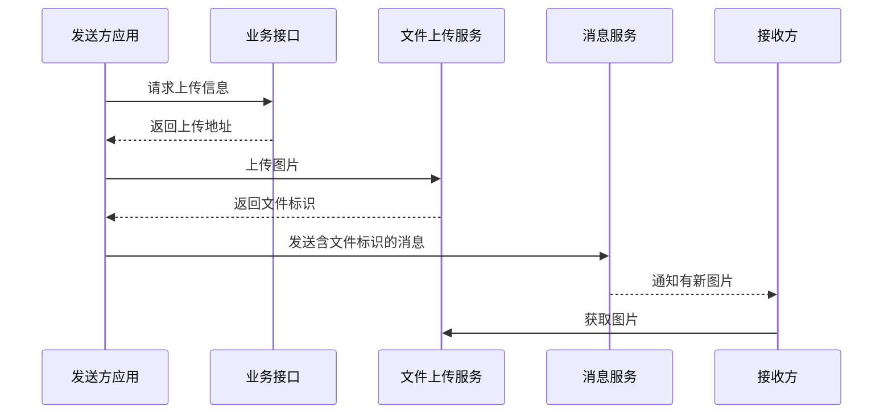
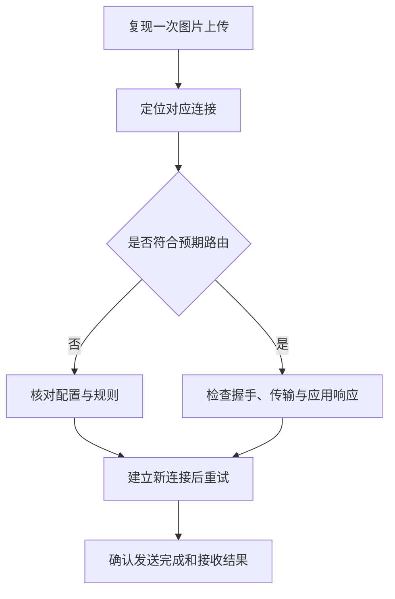

## 简介

网络问题里，有一种现象很容易让人困惑：浏览器访问网站很快，聊天软件也能收发文字，唯独图片一直转圈。打开代理客户端，节点延迟看起来正常，规则也写着直连，于是又回到那个问题——到底是哪一段出了问题？

我们可以把“网络正常吗”换成一个更具体的问题：**刚才那次图片发送，建立了哪些连接，分别走到哪里，又停在哪一步？**

下面用一个虚构的聊天应用说明排查过程。域名、进程名和连接记录都只是示意，不对应某个实际账号或服务。

## 一次操作，可能经过几组服务

先把图片发送想象成一个简单过程：应用向业务接口申请上传信息，把文件传给存储服务，再通知消息服务发送完成。接收方随后从另一条下载路径获取图片。



这张图只是一个可能的设计，但已经足够解释为什么“官网能打开”说服力有限。官网首页、登录接口、图片上传地址和图片下载地址，可以使用不同的域名、CDN 与连接方式。一个入口正常，无法替代其余路径的验证。

文字能发而图片不能发，至少让我们有了一个更小的排查范围：先观察图片操作新增的连接，再判断是不是公共登录链路出了问题。

## 找到这一次操作对应的连接

第一步不急着修改规则。先记录当前启用的配置、运行模式和节点，再打开客户端的连接视图，记下发送一张无敏感内容的测试图片的时间。

以 Mihomo 为例，连接接口可以提供进程、目标地址、命中规则、代理链以及上传和下载字节数。观察界面背后也可以使用同类信息。[Mihomo：连接 API](https://wiki.metacubex.one/api/#connections)

下面是一段重新编写的连接记录节选：

```json
{
  "metadata": {
    "process": "ExampleChatHelper",
    "host": "upload.example.com"
  },
  "rule": "DomainSuffix",
  "rulePayload": "example.com",
  "chains": ["DIRECT"],
  "upload": 8192,
  "download": 0
}
```

它告诉我们，这个辅助进程建立了一条命中直连规则的连接，有少量上行数据，还没看到下行数据。它没有告诉我们图片已经上传成功，也没有说明这些字节全都是图片内容。

有时目标只显示为 IP，域名字段为空；有时连接来自辅助进程，名称和应用主进程并不一样。此时仅搜索应用名称或官网域名，都可能漏掉真正失败的连接。

还要注意，`DIRECT` 描述的是这个代理内核选择的出站方式。操作系统中的其他 VPN、企业网络和上游路由，仍可能改变后续路径。

## 命中规则之后，还要看请求停在哪一步

确定目标以后，可以用一个不含账号信息、允许测试的公开 HTTPS 地址做补充检查。下面命令里的本地端口是示例，需要替换成客户端实际提供的 HTTP 代理端口：

```bash
curl --disable --silent --show-error \
  --proxy http://127.0.0.1:7890 --noproxy '' \
  --connect-timeout 10 --max-time 30 \
  --output /dev/null \
  --write-out 'http=%{http_code} dns=%{time_namelookup} connect=%{time_connect} tls=%{time_appconnect} first=%{time_starttransfer} total=%{time_total}\n' \
  https://example.com/
```

`connect` 是从开始到 TCP 连接建立的累计时间；经过本地 HTTP 代理时，这条 TCP 连接通常只是到本地代理。`tls`、`first` 和 `total` 分别记录到握手完成、首字节到达以及整个请求结束的累计时间。它们不是几段可以直接相加的耗时。[curl：write-out](https://curl.se/docs/manpage.html#-w)

这也解释了一个常见误读：连接本地代理只花了很短时间，不代表本地到远端节点的链路很快。中间的代理协商、隧道建立与目标站点握手，可能体现在后续时间里。经过代理时，两个字段相减也未必能单独分离出“纯 TLS 耗时”。

如果想做应用层绕过代理的对照，可以使用：

```bash
curl --disable --silent --show-error --noproxy '*' \
  --connect-timeout 10 --max-time 30 \
  --output /dev/null \
  --write-out 'http=%{http_code} total=%{time_total}\n' \
  https://example.com/
```

这只让 curl 不使用应用层代理。**TUN 仍然可能接管请求**，所以不能把这一组结果自动标成“物理直连”。做对照时，要把接管方式也记录下来。关于这两层的关系，可以接着看[系统代理与 TUN 的区别]()。

命令测试有助于判断基础连接卡在哪里，但它仍然不是聊天软件的上传测试。测试地址、登录状态、连接复用和请求体都不同，最后还得回到原应用。

## 改规则和换协议，要分开验证

假设连接记录显示上传地址走了预期之外的远端节点，我们就有理由检查域名规则、规则顺序与当前配置。修改后重新加载配置，再让应用建立新的相关连接，观察它是否按预期出站。

如果已经命中预期的直连规则，就不该继续无限扩充直连域名。尤其不宜因为一个上传域名属于某家云厂商，便把整个云厂商的共享域名后缀都放行。规则范围越大，越容易顺带改变其他服务的路径。

另一种情况是，走远端节点的连接反复断开，日志出现 `timeout: no recent network activity`。这是一条排查线索，不能仅凭这一句判断“UDP 被限制”。Hysteria 的排障文档也把地址、监听、防火墙、混淆配置和网络路径等列为需要检查的因素。[Hysteria 2：Troubleshooting](https://v2.hysteria.network/docs/advanced/Troubleshooting/)

这时可以保持目标地址和规则不变，只更换一条已知可用的 TCP 或 QUIC 路径进行对照。一次只改一个因素，才比较容易理解结果。两条路径表现不同，说明值得继续调查它们的差异，并没有直接证明某个协议在所有网络中都更好。



图里的两条分支对应两类问题。规则负责把连接送往哪里，握手与传输负责这条路径能否工作，应用响应才进一步说明业务是否完成。

## 把修复落到实际操作上

最后的验证可以很朴素：同一设备、同一网络，连续发送几张没有隐私内容的测试图片，确认发送结束、接收方可打开；必要时再分别检查 Wi-Fi 和移动网络。

记录结果时，我更愿意写“这次上传成功，连接走了预期路径”，而不是笼统地写“网络已经正常”。如果网页测试通过，但原应用还没有重试，结论就停在网页测试这一层。

排查记录也不需要保存整个聊天截图或完整请求。操作时间、客户端版本、命中规则、耗时与错误类型，通常已经足够帮助下一次定位。上传链接中的签名参数、会话标识和授权头，应留在自己的受控环境里。
