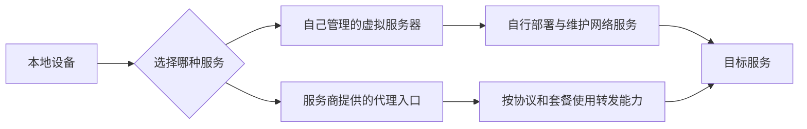

## 简介

找网络服务时，经常会看到 VPS、独享 IP、静态住宅、ISP 代理这些名字。它们都可能提供一个固定的出口地址，于是很自然地想把价格和带宽放在一起，选一个更划算的。

但真正使用时才会发现：有的交付了一台 Linux 服务器，有的只给一个代理地址；有的可以自己部署服务，有的只能连接规定的端口。网页浏览没问题的产品，也未必能支持另一种应用的网络请求。

我们先假设一个简单需求：几台设备需要一个长期稳定、容易维护的出口。沿着这个需求看，至少有四件事要分开：**能控制什么、地址是什么属性、怎样接入，以及实际链路表现如何。**

## 买到一台服务器，和买到一个代理入口

VPS 提供的是虚拟服务器。以 DigitalOcean Droplet 为例，官方将它定义为运行在虚拟化硬件上的 Linux 虚拟机。[DigitalOcean：Droplet Quickstart](https://docs.digitalocean.com/products/droplets/getting-started/quickstart/)

在这样的服务器上，我们可以安装网络服务、查看日志、控制防火墙，也可以运行与代理完全无关的网站或开发工具。相应地，系统更新、服务启动、访问凭据和备份也需要自己维护。

代理服务交付的通常是一种已经运行好的转发能力。客户端获得入口、认证方式和使用额度，通过约定的协议提交连接请求。你能控制哪些参数，取决于服务商开放的接口，不等于拿到了服务器管理权限。

两条路径最后都能到达目标服务，但责任划分不同。比较它们时，先想清楚自己需要的是服务器控制权，还是只需要现成的网络入口，后面的选择会简单很多。

## 固定、独享、住宅，描述的是不同属性

接着看地址。下面几个词经常同时出现在产品页面上，却分别回答着不同问题：

| 描述 | 主要回答的问题 | 不能单独保证什么 |
| --- | --- | --- |
| 固定或静态 | 地址在约定时间内是否保持不变 | 是否由你独享、是否属于住宅接入 |
| 独享 | 约定范围内是否分配给单一客户使用 | 地址历史、线路质量和目标服务兼容性 |
| 数据中心 IP | 地址与数据中心网络的关联 | 某一条具体访问路径的性能 |
| 住宅或 ISP 属性 | 地址与接入运营商、住宅网络的关联 | 代理程序实际运行在家庭设备上 |
| 轮换或粘性会话 | 多次连接怎样选择和保留出口 | 保留时间之外地址仍不变 |

尤其是“静态住宅”和“ISP 代理”，不能只按名字理解成某个家庭路由器。不同供应商对产品名称的使用并不完全一致。例如 IPRoyal 的说明明确写到，其静态住宅代理的地址与 ISP 关联，但服务托管在数据中心。这是该供应商的产品定义，不能机械外推到所有同名产品。[IPRoyal：静态住宅代理的来源](https://help.iproyal.com/en/articles/7222102-are-the-proxies-from-real-residential-ip-addresses)

因此，固定 IP 可以是机房 IP，独享代理也可以托管在机房。这些属性可以组合，并不是一条从“普通”到“高级”的排名。

## 地址属性不会自动带来协议能力

再看怎么接入。产品写着支持 SOCKS5，说明它提供了某种代理接口，但仍需要确认客户端和服务端分别实现了哪些能力。

SOCKS5 标准里既有建立 TCP 连接的 `CONNECT`，也有用于 UDP 转发的 `UDP ASSOCIATE`。存在标准定义，不代表每个产品、套餐和客户端都开放了全部能力。[RFC 1928：SOCKS Version 5](https://www.rfc-editor.org/rfc/rfc1928)

这会直接影响日常使用。通过 SOCKS5 的 `CONNECT` 成功访问 HTTPS 网站，能说明对应的 TCP 转发路径可用；如果另一个应用需要 UDP，还要验证对应的转发能力。DNS 在哪里解析、长连接能保持多久、多设备并发怎样计算，也都需要另看。

同一家供应商的不同产品也可能不同。例如 IPRoyal 的协议说明分别列出了住宅、ISP 和数据中心产品的支持范围。阅读时应当对应到具体产品，不能把一个页面上的“支持 UDP”套到所有套餐上。[IPRoyal：支持的协议](https://help.iproyal.com/en/articles/7222799-which-internet-protocols-does-iproyal-support)

此外，SOCKS5 这个名称本身不承诺传输加密。应用自己的 HTTPS、客户端到代理的保护方式，以及代理之后的连接，需要分别理解。一个看起来漂亮的 IP 类型标签，无法替代这些连接层面的约定。

## 带宽数字，和访问体验之间还隔着一条路径

假设有两种产品，页面上都写着很高的端口带宽。它们的实际体验仍可能不同，因为一个请求经过了本地网络、接入线路、服务商网络与目标服务，任何一段都可能成为瓶颈。

端口带宽描述某处接口或产品限制，月流量描述可传输的数据总量；应用体验还受到时延、丢包、拥塞、连接建立和目标服务响应影响。仅比较两个带宽数字，很难回答“每天使用起来是否顺畅”。

多加一层转发也需要有明确目的。例如下面这条路径：

它可能满足出口统一或访问控制需求，也增加了一段连接和一个故障点。是否值得保留，要看它解决的问题，而不是默认“节点越多越稳”。

做小范围验证时，可以固定设备、网络和目标操作，交替测试不同出口。记录登录、下载、上传与长连接的成功情况，同时保留超时次数。不要只挑一次最快的结果；稳定完成工作通常比偶尔的峰值更有意义。

## 查询 IP 信息，能知道到哪一步

拿到一个地址后，RDAP、ASN 和地理数据库可以提供不同线索。RDAP 用于查询互联网资源的注册信息；它并不是零售订单查询工具，无法靠它还原购买人或具体套餐。[ARIN：RDAP](https://www.arin.net/resources/registry/whois/rdap/)

地理数据库又是另一种信息来源。它对地址位置进行估计，存在精度和更新限制。MaxMind 也明确说明，IP 地理数据不足以定位特定家庭、个人或街道地址。[MaxMind：地理定位准确性](https://support.maxmind.com/knowledge-base/articles/maxmind-geolocation-accuracy)

所以看到某个 ISP 的名字，可以继续核对供应商的产品说明；看到某个城市，也不能据此认定机器真的摆在那里的家庭中。把这些结果当成辅助证据，比寻找一个能给 IP 下最终结论的标签更实用。

## 回到最初的使用需求

如果需要自己运行服务、检查日志并维护配置，VPS 提供的控制权更直接。如果只是让指定应用通过一个现成入口访问网络，托管代理可能减少维护工作。如果关键需求是保持固定出口，就进一步核对地址保留、会话和更换规则。

选择时可以先写下必须完成的几个操作，再用候选产品逐一验证。这样最终买到的是能完成这些操作的服务，而不只是几个听起来更好的产品名。真实地址、认证链接和测试账号可以留在自己的记录中；对外交流，只需描述能力、条件与结果。
