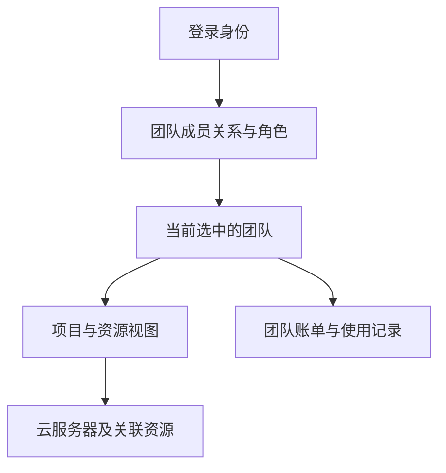

## 简介

假设我们租了一台云服务器，平时通过 SSH 维护，很少打开云平台。过了一段时间，需要查看账单，登录后却发现服务器列表是空的。

这个时候，很容易把几件事连在一起：登录成功了，说明账号没有问题；列表里没有机器，说明机器已经被删除；旧地址还能连接，说明服务器肯定还在。

这些判断各自都少了一步。云平台里的“我是谁”“我能管理什么”和“现在运行着什么”，并不是同一个问题。我们可以沿着这台假想服务器，把它们逐步分开。文中的场景用于解释排查方法，不对应任何实际账号或资产。

## 登录成功之后，还要进入正确的范围

先看登录这一步。

登录证明的是平台接受了某种身份认证。这个身份可能通过邮箱密码建立，也可能关联第三方登录。至于这个身份能查看哪些服务器，还要看它加入了什么团队、拥有怎样的角色，以及当前界面正在显示哪个范围。

以 DigitalOcean 为例，个人账户页面会列出所属团队；进入团队后，成员角色决定能够访问哪些资源、账单和设置。同一个人可以在不同团队之间切换。[个人账户设置](https://docs.digitalocean.com/platform/accounts/settings/)、[团队成员与角色](https://docs.digitalocean.com/platform/teams/how-to/manage-membership/)

图中的项目是一种组织资源的方式。比如把测试环境和生产环境分别放进两个项目，打开测试项目时，自然不会在其中看到生产服务器。DigitalOcean 的项目允许资源在项目之间移动，所以某个项目中的空列表，也不能代表整个团队没有资源。[项目说明](https://docs.digitalocean.com/products/projects/getting-started/quickstart/)

实际排查时，我会先确认页面显示的登录身份、当前团队和成员角色，再看项目、资源类型及筛选条件。使用按区域展示资源的平台时，还需要核对区域。这样做是为了先弄清楚“这张列表查询的是谁的哪些东西”。

如果团队和历史记录对不上，只能先记录这个差异。它可能来自成员关系变化、权限调整，也可能需要平台协助核查。仅凭一个不同的团队标识，还不足以推断用户换过账号，更不能直接认定资源已经丢失。

## 一台服务器需要怎样的身份证明

接下来，假设我们还记得服务器原来的地址，连接后发现某个端口可以响应。

这条证据有用，但它回答的问题很有限：当前网络路径上，有一个端点在那个地址和端口提供响应。它没有告诉我们，这个端点属于哪个云账户，也没有证明它就是原来的虚拟机。

地址可能经历过释放和重新分配；同一个入口也可能转发到后端服务。因此，确认资源时，更适合把平台资源 ID、所属团队、创建记录和历史配置放在一起核对。名称便于记忆，资源 ID 用于关联记录，网络地址用于访问，三者承担的作用不同。

SSH 主机密钥可以提供另一条线索。客户端会保存并检查已知主机密钥；与事先可信保存的指纹匹配，有助于确认对端仍然持有那份密钥。[OpenSSH 手册](https://man.openbsd.org/ssh.1)

但这仍然不等于云平台上的资源归属证明。主机密钥可能被备份、迁移，重新安装系统也可能改变它。如果没有可信的历史指纹，只是从当前端点重新取了一遍公钥，也没有完成前后对照。

所以，“端口能连”“SSH 身份相符”“资源归属确认”应当分别记录。前一项成立，可以继续调查后一项，不能省略中间的核对。

## 资源列表和账单要一起看

服务器找不到时，另一个常见疑问是：它还会产生费用吗？

这个问题不能靠网页是否打开、SSH 是否在线来回答。计费取决于云平台对资源的记录和产品规则，服务停止运行与资源停止计费之间可能存在区别。

例如，DigitalOcean 的套餐型 CPU Droplet 关机后仍保留计算资源，因此仍会计费；对应实例的计费在销毁后结束。这是该产品的规则，不能直接套用到所有云厂商和所有实例类型。[Droplet 计费说明](https://docs.digitalocean.com/products/droplets/details/pricing/)

也就是说，关机状态只能说明机器停止运行。要确认费用，需要查看正确团队下的使用明细和账单，并核对资源 ID、计费时间及关联项目。实例之外的存储、快照或其他服务，也应按照各自的生命周期和计费规则检查。

如果准备停止使用，先确认数据备份、资源归属和依赖关系，再按平台流程释放相应资源。处理完后还要回看使用记录，区分已经发生的费用和后续是否继续产生费用。

## 留下能帮助下一次排查的记录

这类问题的困难，往往在于创建服务器时只记住了一个地址。几个月后，登录方式、团队名称和用途都需要重新猜。

我更愿意保留一份简单的私有资产记录：

| 记录内容 | 后续用来核对什么 |
| --- | --- |
| 平台、登录方式、所属团队 | 从哪里进入管理范围 |
| 资源 ID、区域、创建时间 | 确认具体资源 |
| 用途、维护人、关联存储 | 判断变更会影响什么 |
| 可信主机指纹、配置备份位置 | 核对连接身份与恢复材料 |
| 账单归属、停用记录 | 跟踪资源生命周期 |

这份记录保存定位信息和凭据的存放位置，密码、私钥、令牌仍放在独立的凭据管理工具里。公开分享排查过程时，只需要展示判断方法；真实邮箱、团队标识、资源地址、账单截图和带参数的控制台链接都不必出现在文章中。

如果仍无法定位资源，就可以通过平台的官方支持渠道提交必要的历史记录，请对方核查账号关联和资源状态。此时，一段明确的事实描述会更有用：当前能看到什么，历史记录是什么，哪些检查已经完成，还有哪一层关系没有确认。

把这些信息提前留下，下一次看到空列表时，我们就能从一条可追溯的记录开始，而不用从“服务器是不是没了”这个猜测开始。
