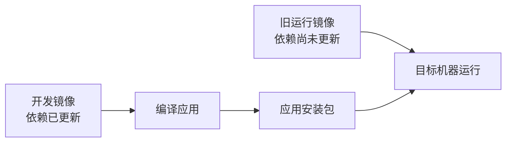
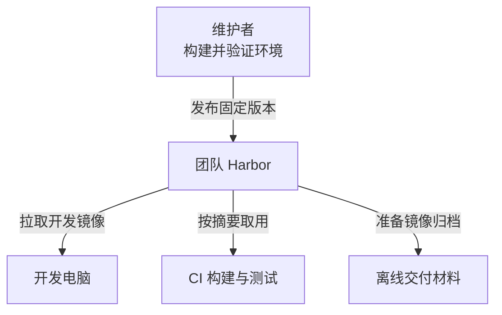
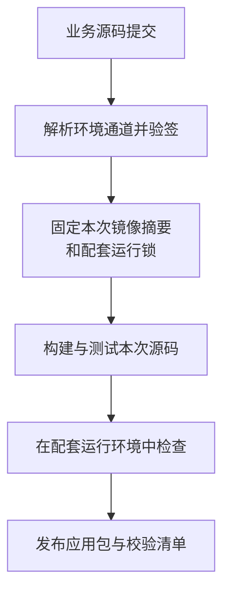
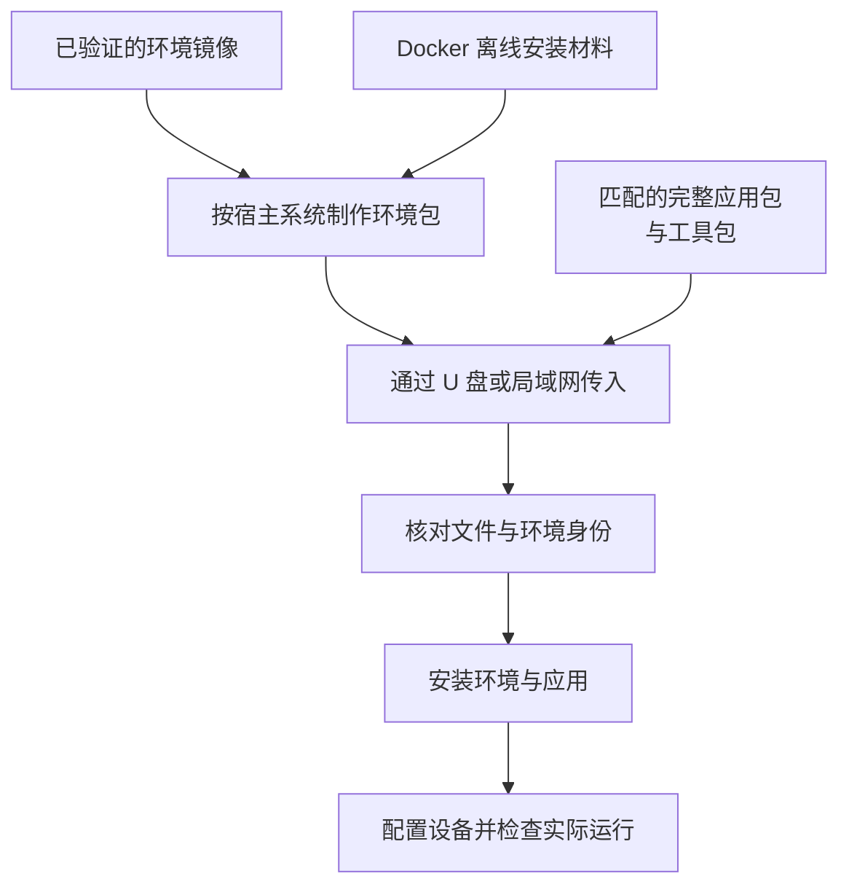

## 简介

一套程序在自己的电脑上编译通过以后，接下来的问题通常很直接：怎样让同事也用上这套环境，怎样把它交到另一台工控机上，后面更新时又应该换哪些东西？

最开始，我们可能会把安装依赖的命令发给同事，让对方照着执行。再往后，会把这些命令整理进 Dockerfile。等到镜像越来越大、现场网络越来越受限，就会想到在自己的服务器上放一个镜像仓库：维护者更新环境，其他人直接拉取。

这也是这次整理 Grimlock 部署流程的起点。

不过，真正把流程接起来以后，会发现“镜像传过去了”只是其中一步。源码可能在宿主机上，程序可能是单独交付的安装包，配置和点云又在另一个目录里。即使对方成功执行了 `docker pull`，正在运行的容器也可能仍然使用旧环境。

接下来从一次依赖更新开始，看看镜像仓库解决了什么问题，以及它怎样与构建、程序交付和离线安装配合。文中的域名和部署路径使用示例值，具体环境以对应版本的交付清单为准。

## 从一次依赖更新说起

### 开发环境更新了，运行环境会跟着变吗

假设采集程序依赖一个通信库。开发时需要它的头文件和链接库，运行时也需要加载对应的动态库。现在开发环境把这个库升级了，程序重新编译通过，随后被复制到另一台机器。

如果另一台机器仍然使用旧库，问题就可能出现在启动或实际调用时。编译器已经检查过当前环境里的声明和链接关系，但它不会替我们检查另一台机器最终加载了哪个文件。

这次整理时遇到的具体情况是：开发镜像沿着自己的版本链升级，增加了 libmodbus 3.2.0；发布镜像仍然保留另一条历史配方。开发侧的变化没有自动进入运行侧。



图里两条线在目标机器汇合。应用来自新环境，运行库来自旧环境；如果只检查应用文件有没有复制成功，就很容易漏掉这层差异。

进一步说，版本号也不是全部。C++ 的编译选项、符号和对象布局会影响二进制兼容性。例如，libstdc++ 的新旧 ABI 可以在同一个库中共存，选择哪套 ABI 并不简单取决于使用了哪个 C++ 语言标准。[GCC 的 Dual ABI 文档](https://gcc.gnu.org/onlinedocs/libstdc++/manual/using_dual_abi.html)解释了这类问题。

因此，交付应用时还需要知道：**它是在什么环境里编译的，又准备在哪个环境里运行。**

### 首版先把两边的环境统一

这次采用了一个直接的办法：构建并验证一份环境镜像，再把同一个镜像分别发布到开发仓库和运行仓库。

```text
grimlock/dev:0.04-20261113.1-amd64
grimlock/runtime:0.04-20261113.1-amd64
```

两个名字表达使用角色，里面的镜像内容相同。首版发布回执核对了两边的 manifest digest 和 image ID 一致，libmodbus、Fast DDS、ROS 以及其他库也随同一份镜像一起交付。

这样做的代价也很明确：运行镜像保留了开发工具，体积没有缩小。对于这一阶段，先减少环境差异，比立即维护两套经过裁剪的配方更容易验证。

以后当然可以把运行镜像做得更小。不过那时需要重新检查实际运行依赖、动态库路径和应用兼容性，不能仅仅因为镜像名字叫 `runtime`，就认为它已经与开发环境匹配。

## 把镜像仓库放到团队自己的服务器

### “本地 Docker Hub”具体是什么

日常交流里，我们很容易把这件事称为“搭一个自己的 Docker Hub”。更准确地说，这次搭建的是 **Harbor 自托管镜像仓库**。

镜像仓库负责保存和分发镜像。Harbor 在这个基础上提供项目、账号、权限和镜像管理入口。团队成员使用 Docker 客户端上传、下载，管理员则可以通过网页查看版本、配置项目和管理成员。



已有的 CI 内部 Registry 不一定需要被删除。它可能只供构建机缓存和拉取，与团队成员使用的共享仓库承担不同职责。需要先分清访问入口和用途，再决定怎样接入。

这次团队的构建与分发由公司服务器承担，个人机器只保留备份用途。这样，同事取得环境时不依赖某个人的电脑是否开机，也不会误把个人测试镜像当成团队发布版本。

### 先看磁盘，再安装服务

部署前有一个很实际的问题：服务器挂载了容量很大的数据盘，但根分区已经接近满载。

如果只把 Harbor 的镜像数据放到大盘上，Docker 自身的镜像层、构建缓存和容器日志仍可能继续写入根分区。最终表现可能是仓库的数据盘还很空，宿主机却已经没有空间启动新容器。

所以，需要一起确认几个位置：Harbor 数据目录、Docker 或 containerd 的存储位置、构建缓存，以及服务日志。Harbor 的 `data_volume` 可以指向已挂载的数据目录，外部对象存储则是另一种选择。[Harbor 配置说明](https://goharbor.io/docs/2.14.0/install-config/configure-yml-file/)列出了相关设置。

这次使用挂载盘上的独立目录和专用 Docker 环境，保留服务器原有项目的运行方式。对共享服务器而言，另一个项目的镜像、缓存和日志都有自己的用途，不能为了腾空间就直接清理。

数据持久化以后，还要验证服务停止、启动和恢复时能否继续读到原来的镜像与配置。把目录挂载出去解决了数据位置问题，备份与恢复仍然需要单独安排。

### 浏览器能打开，不代表 Docker 已经信任它

仓库通过 HTTPS 提供服务。如果使用内部 CA 签发证书，客户端需要信任这套 CA，证书还需要包含实际访问的域名或 IP。浏览器和 Docker 的信任配置也可能不同。[Harbor 的 HTTPS 配置文档](https://goharbor.io/docs/2.14.0/install-config/configure-https/)说明了服务器证书和客户端信任的配置方式。

例如，下面是普通 Linux Docker 客户端的证书目录示意。`registry.example.com:8443` 必须替换为实际仓库入口：

```bash
REGISTRY='registry.example.com:8443'

sudo install -d -m 0755 "/etc/docker/certs.d/${REGISTRY}"
sudo install -m 0644 harbor-ca.crt "/etc/docker/certs.d/${REGISTRY}/ca.crt"
```

这里分发的是 CA 的公开证书。服务器私钥和 CA 私钥仍留在受控位置，不需要交给普通拉取镜像的成员。

还需要区分网络可达性和项目权限。一个 Harbor 项目设为 Public，表示能访问该仓库的人可以匿名读取这个项目；它不会自动让内网服务暴露到公网。需要上传镜像的维护者仍要登录并获得相应项目权限。成员角色和项目公开性可以分别配置。[Harbor 项目配置](https://goharbor.io/docs/2.14.0/working-with-projects/project-configuration/)

## 更新一次环境，实际上经过哪些步骤

### commit、push 和 pull 各自做什么

假设维护者在专门的环境维护容器里调整了依赖。退出容器后，可以通过 `docker commit` 把容器文件系统中的变化保存成新的本地镜像，再标记目标仓库地址并推送。

下面只演示这几个 Docker 动作之间的关系，假设维护容器名为 `env-maintainer`。先保存候选镜像：

```bash
REGISTRY='registry.example.com:8443'
VERSION='0.04-20261113.2-amd64'

docker commit env-maintainer "grimlock-environment:${VERSION}"
```

接着从这份候选镜像创建验证环境，检查依赖版本、实际动态链接以及相关应用的构建和运行。验证通过以后，再在同一个 shell 中执行上传：

```bash
docker tag "grimlock-environment:${VERSION}" "${REGISTRY}/grimlock/dev:${VERSION}"
docker login "$REGISTRY"
docker push "${REGISTRY}/grimlock/dev:${VERSION}"
```

`commit` 生成本地镜像，`tag` 给它增加引用，`push` 才把内容上传到仓库。另一台机器执行 `pull`，才会把指定镜像下载到自己的本地存储。它们是几次不同的操作，Git 的提交也不会自动完成这些步骤。

对 Grimlock 的统一环境，正式发布还要把同一镜像成对发布到 `dev` 和 `runtime`，核对远端摘要与平台，再记录发布清单并签名。只推送上面示例中的一个仓库，还没有完成项目的正式发布流程。

每次依赖变化都需要新版本和相应验证。旧版本测试通过，可以说明旧版本的情况，不能替新容器里的修改作保证。

### 挂载目录里的代码不会被 commit 带走

这里有一个很容易踩到的边界。开发时，我们通常把宿主机的项目目录挂载进容器：

```text
宿主机项目目录
       │ 绑定挂载
       ▼
容器内 /HomeInDocker
       ├── src/
       ├── install/
       └── data/
```

这些文件虽然能在容器里看到、修改和使用，实际仍属于宿主机目录。`docker commit` 不包含挂载卷中的数据，绑定挂载的工作目录同样不能靠它打进镜像。[Docker commit 文档](https://docs.docker.com/reference/cli/docker/container/commit/)明确说明了这一限制。

因此，维护者保存了容器里的依赖环境，并不代表同时保存了挂载进去的源码、应用安装树、标定结果或点云。

把这几类内容分开以后，后续更新就容易理解了：

| 内容 | 主要交付方式 | 变化时关注什么 |
|---|---|---|
| 系统依赖、ROS、中间件和动态库 | 版本化环境镜像 | 架构、依赖和镜像身份 |
| 业务源码 | Git 仓库 | 分支、提交和代码审查 |
| 编译后的程序、脚本和工具 | 完整应用包或受约束的模块包 | 来源提交、运行环境和包校验 |
| 设备配置、标定和业务数据 | 部署目录及相应备份 | 所属设备、数据版本和保留策略 |

这张表也解释了为什么引入 Harbor 后，Dockerfile 仍然要保留。镜像方便分发已经验证的环境，Dockerfile 记录环境怎样建立。临时容器中的修改可以先保存为快照，稳定的依赖变化还应该回到配方和版本记录里。

保留 Dockerfile 也不等于每次重建都会得到完全相同的文件。如果父镜像或软件源会更新，重建结果仍可能变化。已发布镜像的摘要、配方版本和依赖来源需要一起记录。

### 标签方便交流，摘要用来固定内容

`latest` 很方便，但它只告诉我们一个名字，不能长期回答“当时拉到的到底是哪份内容”。即使给标签加了日期，如果仍允许覆盖，同一个名字也可能在不同时间指向不同镜像。

固定版本标签可以帮助人阅读；digest 则用于引用确定的镜像内容。Docker 支持通过 `仓库@sha256:摘要` 拉取镜像。[Docker pull 文档](https://docs.docker.com/reference/cli/docker/image/pull/)给出了这种用法。

这次的做法是保留带日期、序号和架构的版本标签，并为固定版本配置不可变规则。发布清单同时记录 registry manifest digest 和本地 image ID。两者描述的对象不同，核验时分别比较对应字段。

签名又解决了另一个问题：这份摘要是否由预期的发布者认可。TLS 验证连接到的服务，签名验证发布者与内容的关系，软件测试检查内容能否满足使用要求。这几项需要配合。

普通 `docker pull` 不会因为仓库里存在签名就自动完成我们要求的验签。项目的显式验签步骤和 CI 中的校验流程仍需要保留。

### pull 完以后，还要确认容器使用了新镜像

已有容器在创建时就选择了自己的镜像。后来把同名标签更新为新内容，或者在宿主机上拉取了另一份镜像，不会自动替换容器原来的文件系统。

所以，一次环境升级还包括重新创建容器，并确认新容器使用了预期镜像。Compose 在检测到镜像或服务配置变化时，也会通过重建容器应用变化。[Docker Compose up 文档](https://docs.docker.com/reference/cli/docker/compose/up/)描述了这个过程。

Grimlock 保留了自己的启动脚本。以下是在具有该脚本的项目根目录中，显式使用已发布开发镜像的示例：

```bash
REGISTRY='registry.example.com:8443'
VERSION='0.04-20261113.1-amd64'

GRIMLOCK_IMAGE="${REGISTRY}/grimlock/dev:${VERSION}" GRIMLOCK_PULL=true \
  bash docker/start_docker.sh
```

脚本会检查镜像引用、实际 image ID 和挂载目录。需要切换环境时重建容器；镜像获取失败则停止，保留已有容器。更新前应保存容器可写层里需要保留的内容，挂载的工作目录则继续由宿主机管理。

指定 `GRIMLOCK_IMAGE` 时跳过本地构建；只有同时设置 `GRIMLOCK_PULL=true` 才会联网拉取，否则使用本地已有的指定镜像。没有指定镜像时，仍保留原 Dockerfile 构建路径。这个区别需要在使用说明里写清楚，否则本想进入现成环境，却可能重新走了一遍本地构建。

## CI 怎样使用这套环境

镜像仓库接好以后，构建服务器也可以拉取已验证的环境，不必在每次业务代码提交时重新安装全部依赖。

但这并不意味着跳过本次源码的构建和测试。复用的是环境，待验证的仍然是新的代码。



这里需要固定的是“本次流水线”的选择。如果构建开始时使用一个环境，测试时又跟着移动标签换成了另一个环境，最后得到的结果就很难解释。

因此，环境通道可以指向当前认可的版本，但流水线在准备阶段解析、验证一次以后，下游使用固定摘要。仓库后来发布新环境，不应让正在运行的构建中途切换。

另一条流程则属于环境维护：依赖变化后，重新构建或保存环境，完成验证，成对发布镜像，生成签名与离线材料，再把新版本纳入 CI 可使用的环境通道。普通业务提交沿用既有环境，直到这条环境发布流程完成。

这样，应用变更和依赖变更都有各自明确的入口，也能在出问题时判断应该退回哪一层。

## 现场没有网络时，怎样把环境交过去

### 镜像归档只是材料的一部分

办公室里能连接 Harbor，不代表现场也具备相同网络。有的工控机甚至还没有安装 Docker。此时需要准备完整的离线材料。

在已经具备 Docker 的两台机器之间，镜像传输可以用下面的方式理解：

```bash
# 在准备材料的机器上，导出已经拉取并验证的镜像。
docker save -o grimlock-runtime.tar \
  registry.example.com:8443/grimlock/runtime:0.04-20261113.1-amd64

# 文件传到目标机器后，导入其本地镜像存储。
docker load -i grimlock-runtime.tar
```

`save` 导出本地已有镜像，`load` 恢复镜像和标签。它们不会把 amd64 镜像转换为 arm64，也不会替我们安装宿主机缺少的 Docker。[Docker save](https://docs.docker.com/reference/cli/docker/image/save/)、[Docker load](https://docs.docker.com/reference/cli/docker/image/load/)分别说明了两种操作。

对于一台全新的工控机，完整材料至少还要覆盖宿主安装依赖、固定镜像、安装器和校验清单，随后再交付匹配的应用包。



### 宿主系统和容器系统是两层

这次准备了 Ubuntu 22.04 和 24.04 两套 amd64 宿主环境包。选择哪个包，取决于工控机宿主系统，因为 Docker 的离线安装材料需要与宿主匹配。

两套包内部导入的业务环境则相同：容器用户空间为 Ubuntu 24.04、ROS 2 Jazzy，包含统一版本的运行库。容器共享宿主内核，因此仍要验证目标宿主和硬件条件，不能只看容器里的发行版名称。

相机媒体服务作为独立配套镜像交付。它与 ROS 应用配合运行，但有自己的版本和生命周期，不必为了打包方便就合并进同一张业务镜像。

这里还有一个容易混淆的地方：**环境包让机器具备运行条件，应用包提供实际业务程序。**只带了环境包，程序不会凭空出现；只带了程序，也不一定具备它要求的依赖。

### 安装前先核对配套关系

对于第一次安装，可以先校验离线材料，再安装环境，随后在新部署目录安装完整应用和工具，最后准备设备配置与业务运行。

新目录的意义是保留旧版本及其恢复入口。配置模板可以帮助建立文件结构，但不能代替某台设备自己的网络参数和标定结果。

后续只修改应用、运行环境保持一致时，可以复用已有环境。单模块更新还需要核对完整基线、公共依赖和配置约束；公共消息或运行库发生变化时，往往需要重新交付配套的完整版本。

因此，判断一个模块包能否使用，不能只看模块名和日期。它需要回答“基于哪个完整版本、要求哪些公共依赖、匹配哪套运行环境”。

## 怎样确认这条流程已经走通

回到最开始的问题：同事能拉到镜像，现场能装上环境，是否就说明部署已经完成？

可以沿着交付过程逐层检查：

| 检查位置 | 要确认的内容 |
|---|---|
| 镜像仓库 | HTTPS、权限和固定版本可用，远端摘要与发布记录一致 |
| 构建环境 | 编译和测试的是本次源码，记录实际镜像身份 |
| 运行环境 | 应用加载匹配的库，运行检查通过 |
| 离线材料 | 所需文件齐全，下载回读与校验通过 |
| 无网新系统 | 能首次安装、导入镜像并完成软件检查 |
| 现场设备 | 配置、标定、传感器和业务流程满足实际要求 |

这几层的结果需要分别记录。构建通过不能替代实际链接检查；离线镜像导入成功，也不能替代设备上的业务验收。

**11 月 13 日的结果**是 Harbor 服务、首版开发与运行配对镜像及其签名已经完成，并保留了原 Dockerfile 和历史现场基线。

**11 月 14 日补充：**后续完成了 CI 接入、完整应用发布，以及 Ubuntu 22.04 / 24.04 两套无网虚机验收。检查覆盖 Docker 首装与重复安装、镜像导入、libmodbus 3.2.0 编译及实际链接、ROS 录包和 MCAP 读回；独立媒体镜像完成身份与程序版本检查。应用包、工具包和环境包也完成了下载与匹配核验。

这些记录证明了构建、软件运行和离线安装流程的结果，现场传感器、控制动作及机械效果仍然需要单独验收。

把流程整理到这里，日常更新时需要做什么就比较清楚了。改业务代码，沿着源码构建和应用发布走；改依赖环境，更新并验证镜像，再交付匹配材料；改设备参数，保留对应设备的配置与标定记录。镜像仓库把环境分发集中起来，版本记录则让我们知道每台机器最终使用了什么。

## 参考资料

Harbor 的部署可以从[配置文件](https://goharbor.io/docs/2.14.0/install-config/configure-yml-file/)和 [HTTPS 配置](https://goharbor.io/docs/2.14.0/install-config/configure-https/)开始阅读，再结合[项目权限设置](https://goharbor.io/docs/2.14.0/working-with-projects/project-configuration/)理解成员访问。

Docker 的 [commit](https://docs.docker.com/reference/cli/docker/container/commit/)、[pull](https://docs.docker.com/reference/cli/docker/image/pull/)、[save](https://docs.docker.com/reference/cli/docker/image/save/) 和 [load](https://docs.docker.com/reference/cli/docker/image/load/) 文档，分别对应环境快照、镜像分发和离线传输。涉及 C++ 运行兼容性时，可以继续看 [libstdc++ Dual ABI](https://gcc.gnu.org/onlinedocs/libstdc++/manual/using_dual_abi.html)，把“库名相同”和“二进制兼容”分开理解。
