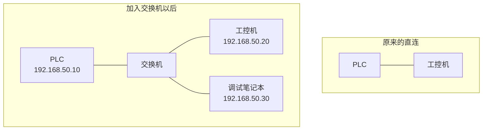
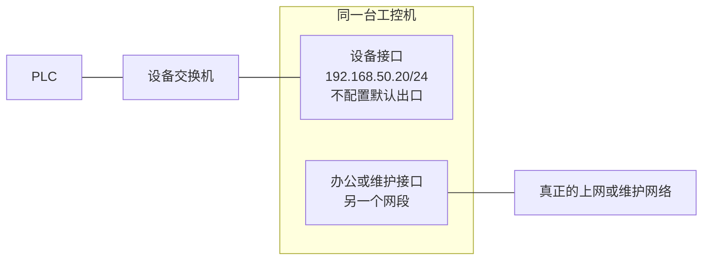

## 简介

PLC 和 x86 工控机原来用一根网线直接连接。到了调试阶段，希望再接一台笔记本，既能查看 PLC 状态，也能检查工控机的通信。于是，一个很自然的想法出现了：在中间加一台交换机，三台设备各接一个口。

对于这里讨论的普通以太网 **Modbus TCP** 通信，这种接法可行。笔记本只是加入网络，不承担 PLC 与工控机之间的转发。拔掉笔记本，两台设备仍然通过交换机连接。

如果直连时已经能够正常通信，保留原来的 IP、协议和点表，单纯增加交换机一般不需要修改应用通信逻辑。不过，接线接通以后，还要分别确认网卡地址、路由、PLC 服务和数据含义。把它们都叫作“配一下 IP”，很容易遗漏真正影响联调的部分。

下面用一套重新编写的示例说明。`192.168.50.0/24` 只是示例网段，设备名称、配置和点表字段也都是教学示意；本文不对应某个现场的网络规划或验收结果。EtherCAT 等其他工业网络有不同机制，不能直接套用这套接法。

## 先把三台设备放在同一张图里



图里的线表示物理连接。PLC 和工控机之间的数据由交换机转发，笔记本不在它们的必经路径上。这一点决定了调试完成后，笔记本可以直接退出网络。

接线时先确认 PLC 上哪个口用于本次通信。有些设备带多个网口，编程口、不同网络接口或专用工业总线口，不一定能够互换。线缆两端贴上设备与端口标签，检查交换机供电、接头固定和布线干扰，也能省掉后面不少猜测。

非网管交换机通常接好电源和网线即可，不需要为业务转发配置 IP，也通常不会自动给三台设备分配地址。网管交换机则要确认三个接入口属于同一 VLAN；对于不发送 VLAN 标签的普通终端，端口的 untagged 成员关系和 PVID 要匹配，也不能有阻止互访的端口隔离或 ACL。

交换机自己的管理 IP 用于访问管理界面，不是 PLC 的地址。应用要连接的仍然是 PLC。接线也应保持清楚的拓扑，不要为了“多接一根更可靠”而随意形成环路。交换机增加了一个转发节点，具体时延和稳定性要在实际负载下测量，不能仅凭连线图给出保证。

## IP 配置，其实有两种不同的地址

工控机程序里填的“PLC IP”，表示请求要发给谁；工控机网卡上的 IP，表示自己从哪个网络身份发出请求。这两个位置都需要配置，但不能填成同一个地址。

对于示例中的独立设备网，可以这样安排：

| 设备 | IPv4 地址 | 子网掩码 | 该设备接口的默认网关 |
| --- | --- | --- | --- |
| PLC | `192.168.50.10` | `255.255.255.0` | 不需要 |
| 工控机设备网口 | `192.168.50.20` | `255.255.255.0` | 不配置 |
| 笔记本有线网口 | `192.168.50.30` | `255.255.255.0` | 不配置 |

这里的 `/24` 就对应 `255.255.255.0`。三个地址各不相同，又处于同一个子网；在相同二层网络中按 IP 互访，不需要默认网关，也不依赖 DNS。没有路由器时，不必为了把表格填满而写一个 `.1`。

实际部署应沿用经过确认的地址规划。准备分配某个地址前，要核对设备清单和现有配置；`ping` 没有回应，可能只是设备关机或不响应 ICMP，不能据此断定地址无人使用。

### 设备网与上网接口怎样共存

工控机经常不止一个接口：一个有线口连接 PLC，另一个有线口或 Wi-Fi 用于办公、维护或上网。这两张网最好使用不同且不重叠的网段。



访问 PLC 的请求走设备接口，默认路由留给真正提供外部连通性的接口。有线连设备、Wi-Fi 上网可以同时存在，Windows 显示有线网络“无 Internet”，也不等于这条设备网络异常。

选择网段时还要检查 VPN、其他网卡和容器网络，避免地址重叠。不要在工控机的两个独立接口上随意配置相同设备网段，否则可能出现路由选择和地址解析不符合预期的情况。

同样，知道现场 IP 只说明知道目标地址。远程电脑能否到达它，还依赖已经建立的维护网络、路由和访问控制；现场加一台交换机不会自动建立远程通路。

## 在 Ubuntu 上，把地址放到正确的网卡

先查看接口和现有路由，再决定修改哪一个口：

```bash
ip -br link
ip -br addr
ip -4 route
```

接口名要结合设备标识、接线与链路状态确认，不能仅凭“第一个有线网卡”来猜。下面假设设备接口叫 `enp2s0`，并且机器已有 Netplan 配置。

备份现有配置后，将需要的字段合并到对应接口中。下面仅展示这部分结构，**不要用它覆盖整台机器的配置**；原有 renderer 和其他接口仍需保留：

```yaml
network:
  version: 2
  ethernets:
    enp2s0:
      dhcp4: false
      addresses:
        - 192.168.50.20/24
```

`addresses` 中同时包含地址和前缀长度。这里没有设置默认路由或 DNS，因为这个接口只用于示例设备网。[Netplan：静态地址示例](https://netplan.readthedocs.io/en/stable/examples/#how-to-configure-a-static-ip-address-on-an-interface)

还要检查同一接口在其他配置文件中是否已有 DHCP 或默认路由设置；新片段没有写某个字段，不代表旧配置已经被删除。若使用 networkd 后端，可以按启动需求考虑 `optional: true`，但这个字段不是跨后端通用的“通信就绪”保证。

修改完成后，先生成并检查配置，再试用：

```bash
sudo netplan generate
sudo netplan try --timeout 120
```

`generate` 主要检查并生成后端配置，不能证明 PLC 已经可达。`try` 会临时应用配置，等待确认，超时则尝试回退；官方也提醒，超时或取消以后应核实是否确实恢复。因此远程修改网络时，仍需保留本地操作或带外恢复条件，不能把回退机制当成绝对保险。[Netplan：try](https://netplan.readthedocs.io/en/stable/netplan-try/)

如果机器本来由 NetworkManager 管理，就沿用现有管理方式，为正确的连接配置静态地址、不设置网关，并根据需要设置 `ipv4.never-default`。不要让几套独立配置同时争抢一个接口。[NetworkManager：IPv4 设置](https://www.networkmanager.dev/docs/api/latest/settings-ipv4.html)

笔记本也按同样的思路处理：在实际接入交换机的有线网卡上配置 `.30/24`，而不是改到 Wi-Fi、VPN 或虚拟网卡上。配置后重新查看路由，确认办公网络的默认出口没有被设备网口抢走。

## 地址通了，PLC 还需要提供什么服务

在这个例子里，工控机是 Modbus TCP client，主动建立连接；PLC 是 server，提供数据访问服务。常见目标端口是 TCP `502`。[Modbus TCP 实现指南](https://www.modbus.org/file/secure/messagingimplementationguide.pdf)

PLC 有网口，或者编程软件能够连接它，并不能证明 Modbus 服务已经启用。不同型号可能需要在工程中开启服务、配置连接资源，或者运行相应的通信功能块。

还要确认 Unit ID。程序中它有时叫 `unit_id`，有时叫 `device_id`，与 IP 地址是不同的字段。它在 Modbus 网关后的设备寻址中尤其重要；直接使用 TCP 的 PLC 如何处理这个字段，应以设备文档和实际配置为准，不能一律填 `1` 或一律填 `0`。

同时检查 PLC 是否限制来源 IP、总连接数和每个来源的连接数。**一台电脑不一定只占一条连接。** 一个应用可能为状态读取、心跳和命令分别创建客户端，再加上笔记本上的调试工具，就可能用掉更多资源。

### 点表决定读到的数据是什么意思

网络连接解决的是请求能否送达，点表则把地址与业务含义对应起来。双方至少需要对齐下面这些内容：

| 点表内容 | 需要说清楚的约定 |
| --- | --- |
| 数据区域与功能码 | 线圈、离散输入、输入寄存器还是保持寄存器；采用哪种读写操作 |
| 地址编号 | 文档显示编号怎样转换为报文中的零基地址 |
| 读取数量 | 连续读取范围是否有效，是否跨越未映射区域或超过设备限制 |
| 数据类型 | 整数、有符号数、浮点数或位字段；各占多少寄存器 |
| 编码顺序 | 字节序、跨寄存器的字序，以及客户端库的转换方式 |
| 单位与缩放 | 原始整数怎样转换成米、毫米或其他工程量 |
| 读写权限 | 哪些点只读，哪些点可写，谁负责写入 |

Modbus 的寄存器是 16 位数据单元，单个寄存器在报文中按高字节在前编码，PDU 中的地址从零开始。PLC 软件里的 `40001`、`%MW` 等表示法涉及各自的地址映射，不能跨厂家直接套用。[Modbus 应用协议规范](https://www.modbus.org/file/secure/modbusprotocolspecification.pdf)

例如，一个采用 float32 表示的量会占用两个 16 位寄存器。两个寄存器怎样组合、是否需要交换字序，以及数值代表米还是毫米，都应由点表约定。数据能解码成一个浮点数，并不意味着解码方式和单位正确。

心跳也属于协议约定的一部分：写哪个点，是翻转、递增还是刷新时间值，周期多长，失联后 PLC 怎样处理，恢复以后是否允许继续执行原命令。这些行为需要双方确认，不能靠单独修改目标 IP 完成联调。

## 应用读哪份配置，容器又走哪张网

现在回到工控机上的程序。下面是假想客户端的配置结构，只用于说明本机网卡配置与目标设备配置的区别：

```yaml
plc:
  host: 192.168.50.10
  port: 502
  device_id: null  # 必须按 PLC 实现填写
  point_table: confirmed-points.yaml  # 需要双方确认的实际点表
```

这不是一份可以直接启动的配置：字段名取决于程序，Unit ID 尚未填写，点表文件也需要真实存在。工控机自己的 `.20` 地址在操作系统网卡上配置，程序里的 `.10` 则是 PLC 的目标地址。

另一个常见问题是改错文件。源码目录中的示例、安装目录中的副本、现场数据目录中的配置，可能同时存在。需要从启动命令、服务定义或启动日志确认实际加载哪一份，以及有没有参数覆盖。保存 YAML 只改变了文件；是否支持热加载、哪些参数需要重启，要看程序的实现。

### Linux Docker 的两种常见情况

如果应用运行在 Linux Docker 的 `host` 网络模式中，容器共享宿主机的网络命名空间。物理网卡地址和路由在宿主机配置，容器不需要再分配一个同网段地址。[Docker：host 网络](https://docs.docker.com/engine/network/drivers/host/)

先检查实际模式，而不是仅凭启动脚本的默认值判断：

```bash
# plc-client 是示例容器名，需要换成实际名称。
docker inspect --format '{{.HostConfig.NetworkMode}}' plc-client
```

这里的应用主动连接 PLC 的 `502` 端口，并不需要为此发布 `502:502`。端口发布用于让外部连接进入容器中监听的服务，和客户端向 PLC 发起连接是两个方向；在 host 模式下，端口映射本身也不生效。

`bridge` 模式同样可能正常访问 PLC。Docker 默认桥接网络通常通过地址转换提供出站访问，仍需检查宿主机路由、过滤规则以及 PLC 最终看到的来源地址，不能把“使用 host”写成 Modbus 通信的必要条件。[Docker：bridge 网络](https://docs.docker.com/engine/network/drivers/bridge/)

以上说明针对 Linux 部署。Mac 上 Docker Desktop 的虚拟化与 host 网络实现有不同边界，本机测试现象不能直接替代目标工控机上的检查。

## 按层验证，先读一个确定的状态点

网线和配置准备好以后，先看系统打算把请求送到哪里：

```bash
ip -4 route get 192.168.50.10
```

在这个示例中，结果应包含 `dev enp2s0 src 192.168.50.20`。如果显示另一个接口或源地址，先处理路由与网段重叠问题。这个命令查询路由决策，不会替我们验证对端在线。[ip-route 手册](https://man7.org/linux/man-pages/man8/ip-route.8.html)

然后分别检查 ICMP、邻居解析和 TCP 端口：

```bash
ping -c 4 -I enp2s0 192.168.50.10
ip neigh show dev enp2s0
nc -vz -w 2 192.168.50.10 502
```

Ping 通说明 ICMP 路径可用，不证明 Modbus 服务正常；Ping 不通，也可能只是对端不响应 ICMP。邻居记录能帮助检查同网段的地址解析，TCP 探测则进一步判断目标端口能否建立连接。这几项结果应该放在一起解释。

Windows 笔记本可以用 PowerShell 检查 TCP 端口：

```powershell
Test-NetConnection 192.168.50.10 -Port 502
```

重点查看 TCP 测试结果、源地址和选中的接口。它验证的是连接，不会替你读取寄存器。[Microsoft：Test-NetConnection](https://learn.microsoft.com/en-us/powershell/module/nettcpip/test-netconnection)

TCP 连通以后，先用独立的只读工具，按双方确认的 Unit ID、功能码和地址读取一个状态点。初次调试可以从低频开始，例如每秒读一次；这只是减小初始负载的例子，运行周期仍需结合 PLC 能力与业务要求确定。

把读到的值与 PLC 在线监控中的值对照，再核对类型、字序、单位和缩放。暂时不要同时开启多个高频扫描工具，也不要让几个工具轮流写同一个控制点。

这里的“只读”需要落到实际行为上。完整应用启动后，可能自动写心跳或执行初始化操作，不能因为操作界面没有点击按钮，就把它当作纯只读测试。确认数据读取和控制归属以后，再进入动作相关联调。

## 笔记本接上交换机，就能抓到全部报文吗

不一定。普通交换机会把已学习目的地址的单播流量转发到相应端口。笔记本接在另一个空闲端口，通常看不到 PLC 与工控机之间的全部已知单播报文。

网卡开启混杂模式，只能帮助接收已经到达这个端口的帧，不能让交换机自动把其他端口的数据送过来。[Wireshark 的以太网抓包说明](https://wiki.wireshark.org/CaptureSetup/Ethernet)也专门讨论了这个限制。需要分析两台设备的通信时，有两种常见办法。

### 直接在工控机上抓包

工控机本来就是通信的一端，可以在对应设备网卡上记录这条流量：

```bash
sudo tcpdump -i enp2s0 -nn -s 0 -c 1000 \
  -w /tmp/plc-debug.pcap \
  'host 192.168.50.10 and tcp port 502'
```

示例限制为最多 1000 个包，使用完整抓取长度，并保存到文件；流量不足 1000 个包时，可以按 `Ctrl+C` 结束。接口、地址和端口都应换成实际确认的值。如果程序使用 bridge 网络，从宿主机物理网口看到的地址也可能已经经过转换。

### 通过端口镜像交给笔记本

如果交换机支持 SPAN 或端口镜像，可以把连接 PLC 或工控机的一个源端口，其接收和发送两个方向的流量复制到独立监控端口：


虚线表示复制，笔记本仍然不承担业务转发。选择通信一端的端口并镜像双向流量，通常就能观察这一端收发的报文；不必为了多抓一些数据，把所有端口都镜像进去。[Cisco：端口与 VLAN 镜像](https://www.cisco.com/c/en/us/td/docs/switches/lan/csbms/350xseries/2_5_7/Administration/tesla-350-550/cb_350_chapter_06.html)

镜像目的端口能否同时作为普通联网端口，要看交换机实现，不能默认笔记本在这个口上还可以正常访问 PLC 或上网。若还要主动调试，可以另外安排普通接入口或独立网卡。

打开抓包文件后，结合时间查看 Modbus 请求与响应、异常码，以及 TCP 重传。镜像流量超过目的端口或抓包设备的处理能力时，也可能漏包。因此，抓包里的缺口需要结合抓包丢弃计数、交换机计数和应用日志判断，不能直接认定业务链路丢了包。

报文文件可能包含真实设备地址、点位值和控制命令。现场留存时按项目方式管理，对外分享问题时只提供必要的脱敏片段，不把原始抓包直接放进公开文章。

## 把现象对应到下一步检查

前面的过程可以整理成一张排障表。它帮助决定先看哪一层，不表示某个现象只可能有一个原因。

| 现象 | 优先检查 |
| --- | --- |
| 端口灯不亮 | 交换机供电、网线、接头、PLC 网口选择与接口状态 |
| 笔记本能连，工控机不能 | 工控机网卡 IP、掩码、路由、来源 IP 限制 |
| Ping 通，502 不通 | Modbus 服务是否启用、实际端口、过滤规则、连接容量 |
| TCP 通，但返回协议异常 | Unit ID、功能码、报文地址、读取数量与映射范围 |
| 有响应，数值却不对 | 地址偏移、数据类型、字序/字节序、单位和缩放 |
| 打开调试软件后掉线 | 总连接数、每来源连接限制、扫描负载、重复写入 |
| 改了配置没有变化 | 实际加载路径、启动参数覆盖、是否需要重新加载或重启 |
| 重启以后又失效 | 持久网络配置、服务使用的配置副本、启动顺序与重连逻辑 |

如果问题发生在应用层，不必反复改交换机；如果路由已经选错，也不应靠不断调整寄存器地址来尝试修复。逐层把问题缩小，才能让每一次修改都有依据。

## 调试电脑离开以后，系统还要继续工作

完成一次读数，只验证了那一刻的一次请求。交付前，还需要按现场允许的条件确认：笔记本断开后持续通信，工控机重启后地址和服务恢复，连接中断后能够按设计重连，心跳失联与恢复时双方行为一致。

动作相关测试则继续向后走一层：写寄存器收到成功响应，只能说明协议操作获得了响应；机械动作是否执行、是否到位、反馈是否正确，还需要 PLC 逻辑、设备状态和现场联调共同验证。

回到最初的问题，加交换机改变的是物理连接方式。把物理接线、IP 与路由、PLC 协议与点表这三层分别确认清楚，调试笔记本就能方便地加入，也能在任务完成后退出，而不成为系统运行的依赖。
